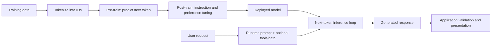
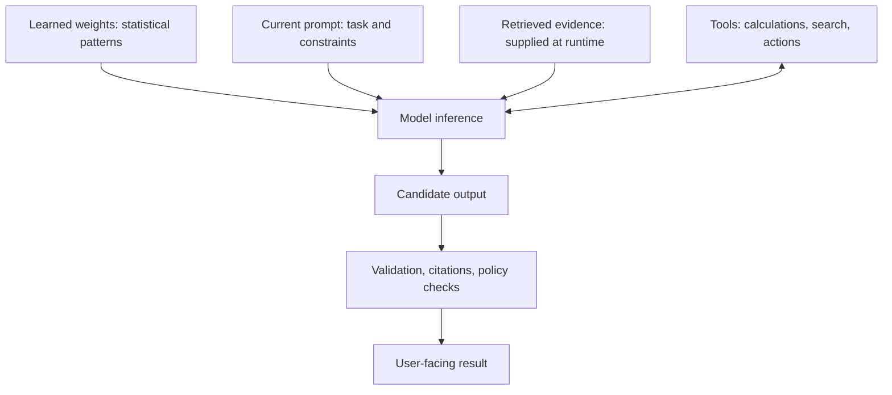

# Module 1 Deep Dive — From Text to a Generated Answer

This lesson follows one request through an LLM system. It distinguishes **what the model learned during training** from **what the application supplies at run time**—a distinction that explains many common failures.

## 1. The complete lifecycle



The model’s parameters are learned during training. A prompt, retrieved document, or tool result is **temporary context** supplied for one inference request; it does not automatically rewrite those parameters or create persistent memory.

## 2. What “predict the next token” means

Given a token sequence `x₁ … xₜ`, a causal language model estimates a probability distribution for the next token:

\[
P(x_{t+1}\mid x_1,\ldots,x_t)
\]

For example, after “The kettle is boiling; please turn off the”, the model may assign high probability to `stove`, but it does not look up a fact and then choose a sentence. It scores vocabulary candidates from learned patterns. Generation appends a selected token and runs the process again:

```text
prompt → logits → sampling/selection → token → append → logits → … → stop
```

This is why an answer can be fluent yet false: **fluency and factual verification are different capabilities**. Tool use, citations, and retrieval can add evidence, but the surrounding application must still verify and present it correctly.

## 3. Training stages, separated

| Stage | What the model sees | What it learns | What this stage does not guarantee |
|---|---|---|---|
| Pre-training | Large text/code corpora | General language patterns and broad associations | Truth, freshness, or obedience to a user’s goal |
| Supervised fine-tuning (SFT) | Demonstrations of prompts and desired responses | A useful instruction-following response style | Correctness on every unseen task |
| Preference optimization (e.g. RLHF or DPO) | Comparisons or preference signals | Which responses are preferred under a training policy | Perfect alignment or absence of bias |
| Inference | Current prompt and any supplied context | No persistent learning in the ordinary API call | Memory across independent requests |

These stages are related but not interchangeable. Fine-tuning can change behavior; retrieval supplies external facts at query time; prompting specifies the current task.

## 4. Tokens, context, and generation budget

Tokenization is a learned encoding, not a one-word/one-token conversion. Punctuation, whitespace, uncommon names, code, and non-English text can all affect token counts. The context limit includes the serialized instructions, conversation history, retrieved material, and reserved output tokens.

```text
context budget = system/developer instructions
               + conversation history
               + user input
               + retrieved/tool context
               + room reserved for output
```

If a request exceeds the limit, the application or API may reject, truncate, or otherwise fail to process it. A bigger context window is not automatically better: irrelevant context costs money and can distract retrieval-based tasks.

## 5. Temperature is only one part of sampling

Temperature rescales logits before sampling. If the next-token logits are `z`, sampling typically uses `softmax(z / T)`. Lower `T` sharpens the distribution; higher `T` flattens it. It does not make the model “more knowledgeable,” and `T=0` is usually best understood as near-greedy decoding rather than a guarantee of semantic correctness. Top-p/top-k filters and provider-specific decoding also matter.

Use lower randomness when outputs must be stable (classification or extraction), and compare settings empirically for creative tasks. Always validate structured outputs regardless of temperature.

## 6. Parameters and memory: a useful estimate

For a dense model with `N` parameters stored at `b` bits each, raw parameter storage is approximately `N × b / 8` bytes. Thus a 7-billion-parameter model at 16-bit precision needs about 14 GB just for weights. Actual inference needs additional memory for runtime buffers and the **KV cache**; quantization can lower weight memory with quality/throughput trade-offs. Architecture, batching, sequence length, and implementation affect real requirements.

Parameter count is not a complete quality score. Training data, architecture, post-training, inference setup, and task fit all matter.

## 7. A practical mental model



An LLM is one component in a larger system. For reliable applications, ask: Where does evidence come from? What can the model do when evidence is absent? Which outputs are validated? What state is persisted, and who controls it?

## Check your understanding

1. Why can an LLM produce a plausible but incorrect date?
2. Which parts of a request consume context-window space?
3. Does adding a fact to a prompt permanently teach the model that fact? Why not?
4. Which would you try first for changing product documentation: prompt engineering, RAG, or fine-tuning?

**Suggested answers:** Next-token training rewards likely continuations, not verified truth; all serialized input and reserved output consume context; prompts are runtime context, not parameter updates; retrieve current documentation with RAG (then evaluate it).

## Continue

Return to the [Module 1 overview](README.md), then study [Module 2: Transformer Architecture](../02-transformer-architecture/README.md).
