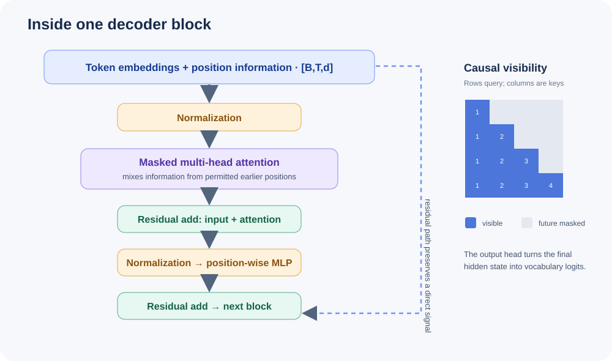

# Module 2: Transformer Architecture

> **Level:** Intermediate | **Time:** ~2 hours | **Prerequisites:** Module 1 | **Code:** attention_demo.py, mini_transformer.py

---

## Why Learn This?

You don't need to understand Transformers to *use* LLMs, but understanding the architecture unlocks:
- Better prompting (knowing how attention works helps you write prompts)
- Debugging (why does the model fail on certain tasks?)
- Building (you'll create your own mini-GPT in this module)
- Research (every advancement builds on this architecture)

---

## The Big Picture

A Transformer is a stack of identical layers that process all tokens in parallel through **self-attention**. Unlike RNNs (which process sequentially), Transformers can attend to any position simultaneously.



```
Input Tokens:  [The, cat, sat, on, the, mat]
                    ↓
            Token Embeddings + Positional Encoding
                    ↓
         ┌──────────────────────┐
         │   Transformer Block  │ ← repeated N times
         │  ┌────────────────┐  │
         │  │  Self-Attention │  │
         │  └───────┬────────┘  │
         │          ↓           │
         │  ┌────────────────┐  │
         │  │  Feed-Forward  │  │
         │  └───────┬────────┘  │
         └──────────┬──────────┘
                    ↓
              Output Logits → Next Token
```

---

## Tokenization & Embeddings

### Tokenization

Text is split into sub-word tokens using BPE (Byte-Pair Encoding) or similar algorithms.

```
"tokenization" → ["token", "ization"]
"unfriendliness" → ["un", "friend", "li", "ness"]
```

### Embeddings

Each token is mapped to a dense vector of size `d_model` (e.g., 768 or 4096).

```python
# Conceptually
embedding = nn.Embedding(vocab_size, d_model)

token_id = 42          # "cat"
vector = embedding(token_id)  # → [0.12, -0.34, 0.56, ..., 0.78]  (d_model floats)
```

The embedding matrix is learned during training — similar words end up with similar vectors.

---

## Positional Encoding

Since Transformers process all tokens in parallel, they have no inherent sense of order. Positional encodings inject position information.

### Sinusoidal (Original Transformer)

```
PE(pos, 2i)   = sin(pos / 10000^(2i/d_model))
PE(pos, 2i+1) = cos(pos / 10000^(2i/d_model))
```

### Learned Positional Embeddings (GPT-style)

```python
position_embeddings = nn.Embedding(max_seq_len, d_model)
```

### Rotary Position Embeddings (RoPE) — Modern

Used in LLaMA, Mistral, and most modern LLMs. Rotates query and key vectors in attention to encode relative positions.

---

## Self-Attention Mechanism

Self-attention allows each token to "look at" every other token and decide what's relevant.

### The Math

For each token, we compute three vectors:

```
Q = X @ W_q    (Query: "What am I looking for?")
K = X @ W_k    (Key: "What do I contain?")
V = X @ W_v    (Value: "What information do I pass on?")
```

Then compute attention:

```
Attention(Q, K, V) = softmax(Q @ K^T / √d_k) @ V
```

Breaking it down:

1. **Q @ K^T**: Compute similarity between every pair of tokens
2. **/ √d_k**: Scale to prevent softmax saturation (d_k = dimension of keys)
3. **softmax**: Convert scores to probabilities (sum to 1)
4. **@ V**: Weighted sum of values — each token gets a blend of information

### Example

```
Tokens: ["The", "cat", "sat"]

Query of "sat" attends to:
  "The" → 0.1  (low — "The" isn't very relevant)
  "cat" → 0.7  (high — "cat" is the subject)
  "sat" → 0.2  (moderate — self-reference)
```

---

## Multi-Head Attention

Instead of one attention operation, we run multiple in parallel (multiple "heads"), each learning different relationships.

```python
# From 02-transformer-architecture/attention_demo.py
from transformers import BertTokenizer, BertModel

model = BertModel.from_pretrained('bert-base-uncased', output_attentions=True)
tokenizer = BertTokenizer.from_pretrained('bert-base-uncased')
```

Each head might specialize:
- Head 1: Syntactic relationships (subject-verb)
- Head 2: Coreference (pronouns → antecedents)
- Head 3: Adjacent tokens
- Head 4: Long-range dependencies

The outputs of all heads are concatenated and projected:

```python
MultiHead(Q, K, V) = Concat(head_1, ..., head_h) @ W_o
where head_i = Attention(Q @ W_qi, K @ W_ki, V @ W_vi)
```

---

## Feed-Forward Network

After attention, each token is processed independently through a feed-forward network (FFN):

```
FFN(x) = GELU(x @ W_1 + b_1) @ W_2 + b_2
```

This is typically 4× wider than `d_model`:
- `d_model = 4096` → FFN inner dim = `16384`

The FFN acts as a "memory" — storing factual knowledge in its weights.

---

## Layer Normalization & Residual Connections

### Residual Connections

Every sub-layer (attention, FFN) has a skip connection:

```
output = x + SubLayer(x)
```

This prevents vanishing gradients and allows training very deep networks.

### Layer Normalization

Applied before or after each sub-layer:

```
output = LayerNorm(x + SubLayer(x))   # Post-norm (original)
output = x + SubLayer(LayerNorm(x))   # Pre-norm (modern, more stable)
```

Modern LLMs use **RMSNorm** (Root Mean Square Normalization) for efficiency.

---

## Causal Masking

In decoder-only models (GPT, Claude), tokens can only attend to **previous** tokens — not future ones. This is enforced with a causal mask.

```
Token: ["The", "cat", "sat"]

Attention matrix:
           The   cat   sat
The    [  1     0     0  ]    "The" can only see "The"
cat    [  1     1     0  ]    "cat" sees "The" and itself
sat    [  1     1     1  ]    "sat" sees everything
```

Masked positions get `-inf` before softmax, so they receive zero attention.

---

## Model Sizes

| Model | Layers | d_model | Heads | Parameters | Context |
|-------|--------|---------|-------|------------|---------|
| GPT-2 | 48 | 1600 | 25 | 1.5B | 1,024 |
| LLaMA 3 8B | 32 | 4096 | 32 | 8B | 8,192 |
| LLaMA 3 70B | 80 | 8192 | 64 | 70B | 8,192 |
| GPT-4 (est.) | ~120 | ~12,288 | ~96 | ~200B | 128,000 |

---

## Modern Innovations

### RoPE (Rotary Position Embeddings)

Instead of adding position info, RoPE rotates Q and K vectors by angles proportional to position. This allows the model to learn relative positions naturally.

### Grouped-Query Attention (GQA)

Instead of separate K, V for each head (MHA), GQA shares K, V across groups of query heads. This reduces memory while maintaining quality.

- **MHA:** Each head has its own Q, K, V
- **GQA:** Heads share K, V within groups (LLaMA 2 70B, Mistral)
- **MQA:** All heads share one K, V (fastest, lower quality)

### Flash Attention

An algorithmic optimization that restructures the attention computation to be memory-efficient, running 2-4× faster on GPUs by using tiling and avoiding materializing the full N×N attention matrix.

---

## Try It Yourself

### attention_demo.py — Visualize BERT Attention

```bash
python 02-transformer-architecture/attention_demo.py --text "The cat sat on the mat because it was tired"
```

This shows how different layers and heads attend to different relationships.

### mini_transformer.py — Build a Mini-GPT

```bash
python 02-transformer-architecture/mini_transformer.py --train
python 02-transformer-architecture/mini_transformer.py --generate
```

Train a small GPT on Shakespeare text and generate new passages.

---

## What's Next?

You now understand how Transformers work internally. Next, we'll learn how to effectively communicate with these models.

**→ [Module 3: Prompt Engineering](../02-prompt-engineering/README.md)**

Learn the art and science of crafting prompts that get the best results from LLMs.

---

## References

- [Vaswani et al., "Attention Is All You Need"](https://arxiv.org/abs/1706.03762)
- [Jay Alammar, "The Illustrated Transformer"](https://jalammar.github.io/illustrated-transformer/)
- [Andrej Karpathy, "Let's build GPT from scratch"](https://www.youtube.com/watch?v=kCc8FmEb1nY)
- [Lilian Weng, "Attention? Attention!"](https://lilianweng.github.io/posts/2018-06-24-attention/)

## Visual Deep Dive

Continue to **[Module 2 Deep Dive](deep-dive.md)** for tensor shapes, attention math, causal masks, residual paths, training loss, KV caching, and knowledge checks.
