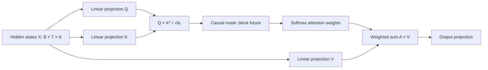
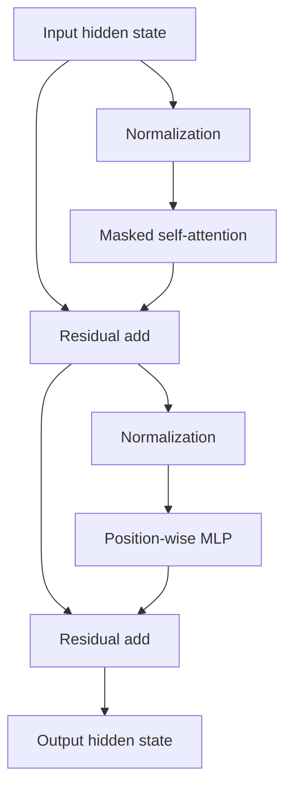

# Module 2 Deep Dive — How a Decoder Transformer Computes

This lesson traces the tensor shapes and information flow through a small decoder-only Transformer. Symbols used below: `B` = batch size, `T` = sequence length, `d` = model width, `h` = number of attention heads, and `dₕ = d/h` = width per head.

## 1. From token IDs to hidden states

The tokenizer maps text to integer IDs. An embedding table `E ∈ ℝ^(V×d)` maps each ID to a learned vector, where `V` is vocabulary size. At position `t`, the model combines token content with position information (the exact mechanism depends on the architecture):

```text
IDs [B,T] → token lookup [B,T,d] → position-aware hidden states [B,T,d]
```

An embedding is not a dictionary definition. It is a trainable coordinate in a high-dimensional space whose usefulness emerges through training and interaction with the rest of the network.

## 2. Attention, derived one step at a time

For hidden states `X ∈ ℝ^(B×T×d)`, learned projections create queries, keys, and values:

\[
Q=XW_Q,\quad K=XW_K,\quad V=XW_V
\]

For one head, similarity scores compare each query position with each key position. Scaling by `√dₕ` keeps dot-product magnitudes manageable as width grows. A causal mask replaces future-position scores with `−∞` before softmax, turning their probabilities into zero:

\[
A=\operatorname{softmax}\left(\frac{QK^T}{\sqrt{d_h}}+M\right),\quad H=AV
\]



At position 4, the attention row can assign weights to positions 1–4, not 5 onward. The weighted sum mixes information from visible positions; each position gets its own contextualized representation.

## 3. Why multiple heads?

Each head has its own learned projections and can represent a different relationship. There is no guarantee that a head corresponds neatly to a human label such as “grammar”; that is a useful intuition, not a hard-coded specialization. Head outputs are concatenated and projected back to model width:

```text
one head: [B,T,dₕ]   h heads: concatenate → [B,T,h·dₕ] = [B,T,d]
```

Grouped-query attention (GQA) shares key/value heads across groups of query heads. Its major practical benefit is reducing KV-cache size and memory traffic at inference while retaining multiple query heads.

## 4. Transformer block and residual path

Modern decoder blocks often use pre-normalization:

\[
X' = X + \operatorname{Attention}(\operatorname{Norm}(X))
\]
\[
Y = X' + \operatorname{MLP}(\operatorname{Norm}(X'))
\]

The residual paths preserve a direct route for information and gradients. The MLP operates independently at each position, while attention mixes information across positions. The MLP is sometimes described as storing factual associations, but this is an oversimplification: information is distributed across weights and layers, and factual retrieval is not a literal database lookup.



## 5. Training objective: shift the sequence

For tokens `[A, B, C, D]`, the model is trained to predict the next token at every available position:

```text
input:  [A, B, C]       target: [B, C, D]
at A → predict B; at B → predict C; at C → predict D
```

Cross-entropy penalizes low probability assigned to the target token. In code, ensure the attention mask prevents future-token leakage; otherwise the training score may look excellent while the model has cheated by seeing the answer.

## 6. Why inference gets expensive

Without caching, generating each new token would recompute key/value projections for the entire prefix. The KV cache retains prior keys and values, so each step computes only the new position’s queries/keys/values and attends over cached history.

```text
Prefill prompt (parallel) → cache K,V → decode token 1 → update cache
                                              ↓
                                      decode token 2 → …
```

The cache grows with batch size, number of layers, sequence length, KV-head count, head width, and bytes per value. Long prompts therefore affect both prefill latency and memory. FlashAttention improves IO efficiency by tiling the attention computation; it does not change the underlying attention formula.

## 7. Three architecture families

| Family | Typical use | Attention pattern |
|---|---|---|
| Encoder-only (e.g. BERT-style) | Representations, classification | Bidirectional context |
| Decoder-only (GPT-style) | Autoregressive text generation | Causal / left-to-right |
| Encoder-decoder (T5-style) | Conditional transformation | Encoder reads input; decoder generates output |

Models and product offerings evolve; avoid treating one table of model sizes or context lengths as timeless facts. Check the model’s current technical documentation.

## Check your understanding

1. For `B=2`, `T=16`, `d=64`, `h=4`, what is `dₕ`? What shape do head outputs have before concatenation?
2. Why is `−∞` used for future positions before softmax?
3. Which component mixes across sequence positions: the MLP or attention?
4. What does KV caching save, and what memory cost does it introduce?

**Suggested answers:** `dₕ=16`, each head `[2,16,16]`; softmax maps masked positions to zero; attention mixes positions; KV cache avoids recomputing prior K/V but consumes memory proportional to cached sequence and model configuration.

## Continue

Return to the [Module 2 overview](README.md) or explore the [mini Transformer](mini_transformer.py).
