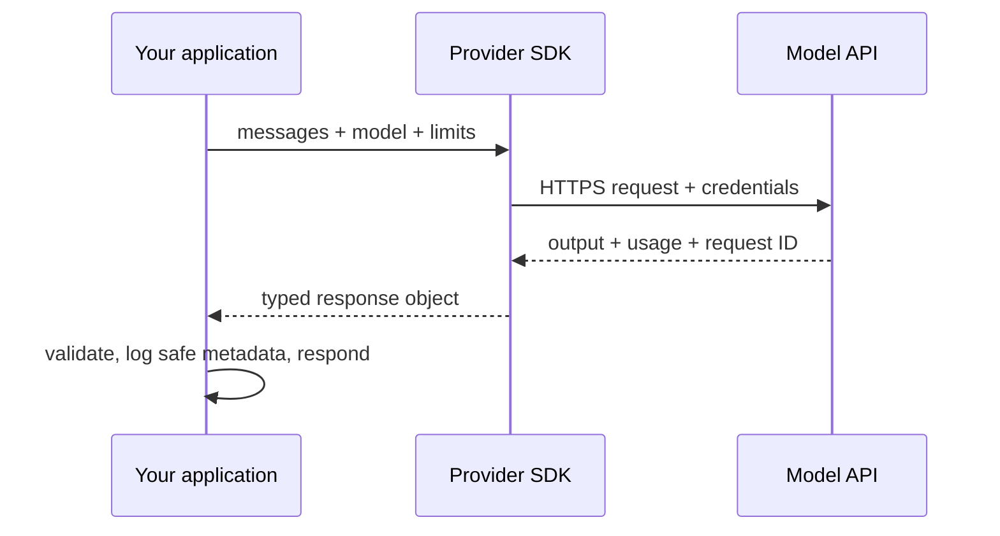
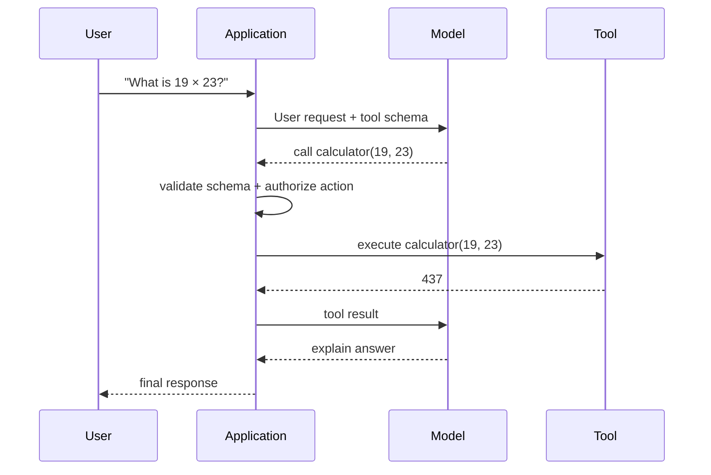

# Module 4 Deep Dive — From Python Call to Model Response

An API call is a networked software operation, not a local function call. Your program serializes a request, authenticates, waits on an external service, then parses a response that can fail, be delayed, or incur usage charges.

## 1. Request/response path



Keep credentials in environment variables or a secret manager. Do not log API keys, private prompts, or sensitive completions by default. Record request IDs, status, model, latency, and token usage where policy permits.

## 2. Chat history is application state

Most chat APIs receive the conversation history on each request. The provider does not infer that two separate calls belong to the same user unless your application sends that state or uses a provider feature explicitly designed for it.

```text
turn 1: [system, user] → response
turn 2: [system, user, assistant, user] → response
```

As the history grows, so does input token use and latency. Bound history, summarize old turns carefully, or retrieve only relevant memories. Preserve the latest user request and necessary instructions; do not silently drop context that changes meaning.

## 3. Output tokens, latency, and streaming

Total latency is roughly the sum of connection/network time, prompt prefill, and decoding. Streaming can improve **time to first visible token**, but it does not necessarily reduce total generation time or cost.

```mermaid
gantt
    title Conceptual user-perceived response time
    dateFormat X
    axisFormat %s
    section Non-streaming
    Wait for full response :0, 8
    section Streaming
    Connection + prefill :0, 2
    Tokens arrive progressively :2, 8
```



With streaming, handle partial responses, disconnects, finish reasons, and safety policies deliberately. Do not assume a stream ended successfully merely because some text arrived.

## 4. Tool calls are a protocol round-trip

The model proposes a structured call; your code decides whether it is permitted, executes it, and returns the result. The model does **not** execute Python or access your database merely by naming a function.



Validate arguments, apply authorization and timeouts, constrain side effects, and cap tool-call loops. For consequential actions (payments, deletion, external messages), require explicit human approval.

## 5. Reliability patterns

- **Timeouts:** set a maximum wait and make cancellation meaningful.
- **Retries:** retry transient errors (e.g. selected rate limits or server errors) with exponential backoff and jitter; do not blindly retry invalid requests.
- **Idempotency:** use provider-supported idempotency keys for operations where repeating a request could duplicate work.
- **Fallbacks:** define which failures can switch provider/model and what quality trade-off is acceptable.
- **Budgeting:** cap input/output tokens, requests per user, and spend.
- **Validation:** parse structured responses and validate semantics before downstream actions.

## 6. Cost calculation

If input and output prices are per million tokens:

```text
estimated_cost = input_tokens / 1,000,000 × input_price
               + output_tokens / 1,000,000 × output_price
```

Prices and model names change; consult current provider documentation rather than embedding old price tables in application logic. Track actual usage returned by the API and compare it with estimates.

## Check your understanding

1. Why must an application resend history for ordinary stateless chat requests?
2. What does streaming improve, and what does it not promise?
3. Which component actually executes a tool call?
4. Which errors are appropriate for retries, and why should retries have jitter?

## Continue

Read the [Module 4 overview](README.md), then move to [Module 5: RAG](../04-rag/README.md).
