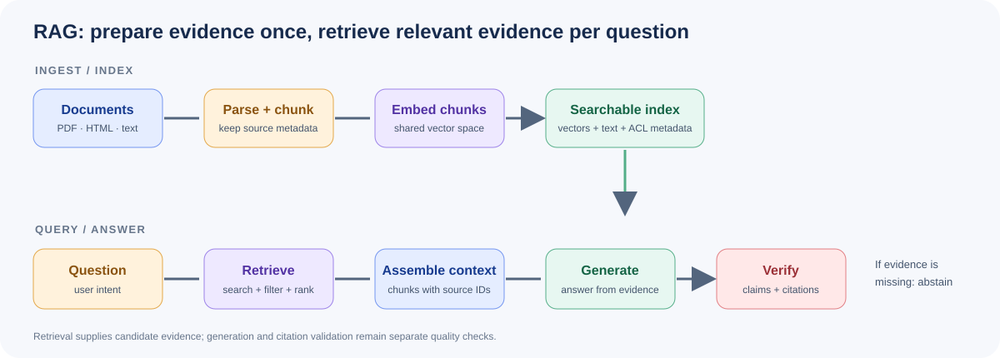

# Module 5: Retrieval-Augmented Generation (RAG)

> **Level:** Intermediate | **Time:** ~2.5 hours | **Prerequisites:** Modules 1-4 | **Code:** rag_pipeline.py, embeddings_demo.py, chat_with_pdf.py

---

## The Problem RAG Solves

LLMs have a fundamental limitation: **they only know what was in their training data.** They can't access:
- Your company's internal documents
- Real-time information
- Private data
- Recently published papers

**RAG** (Retrieval-Augmented Generation) solves this by combining:
1. **Retrieval** — Find relevant documents from a knowledge base
2. **Generation** — Feed those documents to an LLM as context

```
Without RAG:           With RAG:
┌──────────┐           ┌──────────┐     ┌──────────────┐
│   LLM    │           │   LLM    │◄────│ Your Data    │
│          │           │          │     │ (Vector DB)  │
│ Training │           │ Training │     └──────┬───────┘
│ data only│           │ data     │            │
└──────────┘           └──────────┘     ┌──────┴───────┐
                                        │  Retriever   │
User: "What's our      User: "What's    │  (Embeddings)│
sick leave policy?"    our sick         └──────────────┘
                        leave policy?"
Answer: "I don't       Answer: "Per your
know."                  HR handbook,..."
```

---

## How RAG Works



```
Step 1: INGEST                    Step 2: QUERY
┌─────────────────┐              ┌─────────────────┐
│  Documents      │              │  User Question   │
│  (PDF, TXT, MD) │              │  "What's the     │
└────────┬────────┘              │   return policy?"│
         │                       └────────┬────────┘
         ▼                                ▼
┌─────────────────┐              ┌─────────────────┐
│  Chunking       │              │  Embed Question  │
│  Split into     │              │  → vector        │
│  small pieces   │              └────────┬────────┘
└────────┬────────┘                       │
         ▼                                ▼
┌─────────────────┐              ┌─────────────────┐
│  Embedding      │              │  Vector Search   │
│  Each chunk →   │              │  Find top-K      │
│  vector         │              │  similar chunks  │
└────────┬────────┘              └────────┬────────┘
         ▼                                ▼
┌─────────────────┐              ┌─────────────────┐
│  Vector DB      │              │  LLM + Context  │
│  Store all      │              │  Generate answer │
│  vectors        │              │  using retrieved │
└─────────────────┘              │  documents       │
                                 └─────────────────┘
```

---

## Key Concepts

### Chunking

Documents are split into small pieces (chunks) for embedding. Common strategies:

| Strategy | Chunk Size | Best For |
|----------|-----------|----------|
| Fixed-size | 500-1000 chars | Simple documents |
| Sentence | 1 sentence | Precise retrieval |
| Paragraph | 1 paragraph | Context-rich |
| Semantic | Variable | Best quality |
| Recursive | Variable | Most flexible |

**Rule of thumb:** 200-1000 tokens per chunk, with 50-100 token overlap.

### Embeddings

Text embeddings are dense vectors that capture semantic meaning. Similar texts have similar vectors.

```python
# "The cat sat on the mat" and "A feline rested on the rug"
# would have very similar embedding vectors
```

Popular embedding models:
- `text-embedding-3-small` (OpenAI) — 1536 dimensions
- `text-embedding-3-large` (OpenAI) — 3072 dimensions
- `BAAI/bge-small-en-v1.5` — Open-source, 384 dimensions
- `all-MiniLM-L6-v2` — Fast, lightweight

### Vector Databases

Specialized databases for storing and searching vectors efficiently.

| Database | Type | Best For |
|----------|------|----------|
| ChromaDB | Embedded | Development, simple |
| Pinecone | Cloud | Production, managed |
| Weaviate | Self-hosted | Advanced features |
| Qdrant | Self-hosted | High performance |
| FAISS | Library | Research, local |
| pgvector | Extension | PostgreSQL users |

---

## Build a RAG Pipeline

### Step 1: Load & Chunk Documents

```python
def chunk_text(text, chunk_size=500, overlap=50):
    chunks = []
    start = 0
    while start < len(text):
        end = start + chunk_size
        chunks.append(text[start:end])
        start = end - overlap
    return chunks
```

### Step 2: Generate Embeddings

```python
from openai import OpenAI

client = OpenAI()

def get_embedding(text):
    response = client.embeddings.create(
        model="text-embedding-3-small",
        input=text
    )
    return response.data[0].embedding
```

### Step 3: Store in Vector Database

```python
import chromadb

chroma_client = chromadb.Client()
collection = chroma_client.create_collection("documents")

# Store chunks with embeddings
for i, chunk in enumerate(chunks):
    embedding = get_embedding(chunk)
    collection.add(
        ids=[f"chunk_{i}"],
        embeddings=[embedding],
        documents=[chunk]
    )
```

### Step 4: Query

```python
def rag_query(question, collection, top_k=3):
    # Embed the question
    q_embedding = get_embedding(question)

    # Find similar chunks
    results = collection.query(
        query_embeddings=[q_embedding],
        n_results=top_k
    )

    # Build context
    context = "\n\n".join(results["documents"][0])

    # Generate answer
    response = client.chat.completions.create(
        model="gpt-4o-mini",
        messages=[
            {"role": "system", "content": f"Answer based on this context:\n\n{context}"},
            {"role": "user", "content": question}
        ]
    )
    return response.choices[0].message.content
```

---

## Best Practices

1. **Chunk size matters** — Too small loses context, too large dilutes relevance
2. **Add overlap** — Prevents cutting sentences in half
3. **Use metadata** — Store source file, page number, date with each chunk
4. **Re-ranking** — After retrieval, use a model to re-rank results by relevance
5. **Hybrid search** — Combine vector search with keyword search
6. **Handle edge cases** — What if no documents match? What if the question is outside scope?
7. **Citation** — Always tell the user which document the answer came from
8. **Evaluate** — Test retrieval quality, not just answer quality

---

## Try It Yourself

```bash
# Ingest a document
python 04-rag/rag_pipeline.py --ingest document.pdf

# Ask a question
python 04-rag/rag_pipeline.py --query "What is the main topic?"

# Interactive chat
python 04-rag/rag_pipeline.py --chat

# Chat with a PDF
python 04-rag/chat_with_pdf.py document.pdf
```

---

## What's Next?

You can build applications that use your own data. But what if you need the model to have specialized knowledge?

**→ [Module 6: Fine-Tuning](../05-fine-tuning/README.md)**

Learn how to customize LLMs for your specific use case.

---

## Further Reading

- [LangChain RAG Tutorial](https://python.langchain.com/docs/tutorials/rag/)
- [LlamaIndex Documentation](https://docs.llamaindex.ai/)
- [ChromaDB Getting Started](https://docs.trychroma.com/docs/overview/getting-started)
- [Pinecone RAG Guide](https://www.pinecone.io/learn/retrieval-augmented-generation/)

## Visual Deep Dive

Continue to **[Module 5 Deep Dive](deep-dive.md)** for the separate ingestion/query paths, chunking trade-offs, retrieval diagnostics, citations, and evaluation.
