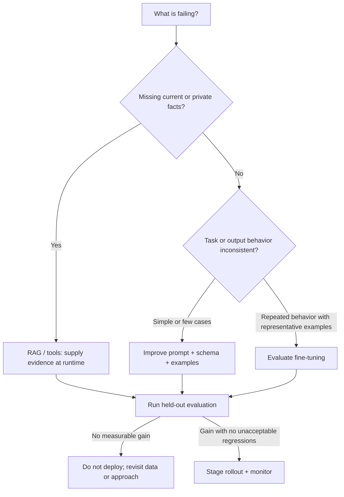
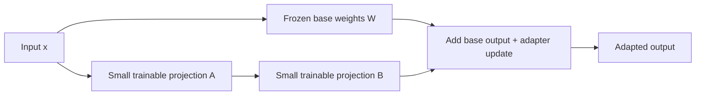

# Module 6 Deep Dive — Fine-Tuning Without Guesswork

Fine-tuning changes model parameters to improve a behavior over examples. It is most useful when the desired behavior is repeated and learnable from demonstrations—not as a convenient database for facts that change frequently.

## 1. Select the intervention based on the failure



## 2. Supervised fine-tuning objective

In supervised fine-tuning, the model receives a conversation prefix and learns to assign probability to the desired assistant tokens. In simplified notation, the objective minimizes negative log-likelihood over target tokens:

\[
\mathcal{L}_{SFT}=-\sum_t \log P_\theta(y_t\mid x,y_{<t})
\]

Typically the loss is applied to the assistant completion, not every prompt token. Exact masking and chat serialization depend on the training implementation. A dataset formatting error can train the model to imitate the wrong role, include unwanted boilerplate, or ignore instruction boundaries.

## 3. Data quality beats raw count

Build a dataset from representative situations, not just repeated paraphrases of a few happy paths. Include missing information, exceptions, refusals where appropriate, and the variation users actually produce. Review outputs for factual correctness, privacy issues, and consistent policy.

```text
Raw examples → deduplicate → remove sensitive data → normalize format
             → split by source/time/user → validate → train + eval
```

Split before training and avoid near-duplicate leakage between train and test. If the same template or source answer appears in both, evaluation may overstate generalization. Keep a final test set untouched while tuning.

## 4. Parameter-efficient fine-tuning: LoRA intuition

Full fine-tuning updates a large weight matrix `W`. LoRA freezes `W` and learns a low-rank update:

\[
W' = W + \Delta W,\qquad \Delta W = BA
\]

where `A` and `B` are much smaller matrices; rank `r` controls update capacity. This reduces trainable parameters and optimizer memory. QLoRA additionally quantizes the frozen base weights and trains adapters, making some larger fine-tuning jobs feasible on smaller hardware. Lower memory requirements do not remove the need for sufficient compute, careful data, and evaluation.



## 5. Evaluate the change, not the training loss

Compare the base and adapted model on the same held-out cases, with the same prompt and decoding settings. Measure the intended target (format validity, task accuracy, style rubric) and guardrails (factuality, refusals, latency, cost, regressions on unrelated tasks). A lower training loss is not evidence that users receive better answers.

Useful evaluation table:

| Case | Expected behavior | Base result | Tuned result | Pass? | Notes |
|---|---|---|---|---|---|
| ordinary request | desired format | … | … | … | … |
| missing evidence | ask/abstain | … | … | … | … |
| policy exception | safe handling | … | … | … | … |

## 6. Operational questions

Before training, decide who can access the training data, how it is de-identified, where artifacts are stored, how a model version is promoted or rolled back, and whether provider/model terms permit the intended use. Record dataset version, training configuration, base model, adapter/model artifact, and evaluation report for reproducibility.

## Check your understanding

1. Why is RAG generally a better fit than fine-tuning for frequently changing policy text?
2. In one sentence, what does LoRA make smaller?
3. Why can train/test duplication inflate results?
4. Which outcomes besides training loss should be checked before release?

## Continue

Read the [Module 6 overview](README.md) and inspect the [sample JSONL data](sample_data.jsonl).
