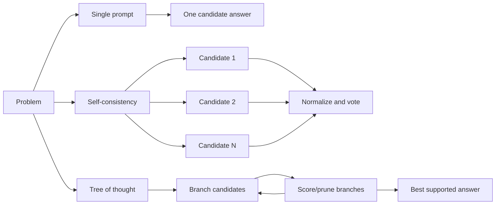
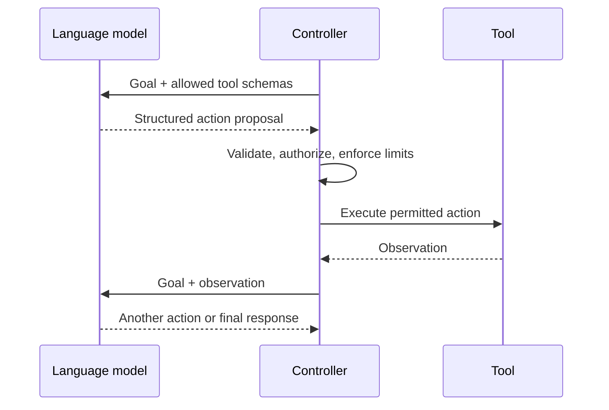

# Module 7 Deep Dive — Reasoning Patterns as Search Strategies

Advanced prompting changes how a task is organized. It does not grant a model perfect reasoning. Each added generation, branch, critique, or tool call has a quality, latency, and cost trade-off; evaluate whether it earns that cost.

## 1. One path, many paths, or a search tree?



### Self-consistency

Sample several solutions and aggregate their **final answers**. This works best when answers can be normalized (numbers, labels, choices). It is not independent evidence: samples come from the same model and can share systematic errors. Do not use majority vote as factual verification.

Worked example: for `18 × 24`, extract a numeric answer from each sample, normalize `$432`, `432`, and `432.0` to the same value, then vote. If answers disagree, return “uncertain” or invoke an exact calculator instead of forcing a winner.

### Tree-of-thought

Generate alternative next steps, score them against explicit criteria, and expand promising branches. A vague “rate your own idea” evaluator may select confident-sounding but invalid branches. Ground scoring in constraints, executable checks, or evidence where possible; cap depth and width to bound cost.

## 2. Decompose the task, then verify joins

Least-to-most prompting breaks a hard request into dependencies. Prompt chaining makes those dependencies explicit in code:

```text
raw request → extract requirements → draft response → verify constraints → final format
                   │                       │                   │
                   └── typed intermediate artifacts; validate every boundary ──┘
```

The join between steps is a common failure point. Validate that each output is present, appropriately typed, and still supported by the original input. If a step fails, stop or repair it; do not silently pass malformed text onward.

Skeleton-of-thought first creates an outline and expands independent sections in parallel. This can reduce perceived latency, but parallel sections may repeat or contradict each other. Add a final coherence pass and a section-level acceptance checklist.

## 3. ReAct: reasoning linked to observations



The controller—not free-form model text—must determine whether an action is allowed and how it executes. ReAct is useful when new observations can change the next step. If a task is a fixed sequence, an ordinary deterministic workflow may be cheaper and safer.

## 4. Meta-prompting as an optimization loop

Candidate prompts should be evaluated against a fixed dataset and a defined metric. Optimize more than one metric when necessary:

```text
candidate prompt → representative eval set → accuracy + format + safety + cost
       ↑                                                   │
       └──────── inspect failures; edit one cause at a time ┘
```

Avoid selecting a prompt because it “sounds clearer.” Keep a held-out set so iterative prompt tuning does not overfit the examples used during optimization. Include adversarial cases and an abstention criterion.

## 5. Choosing a technique

| Need | Pattern to consider | Add a check |
|---|---|---|
| Reduce variance on answerable reasoning question | Self-consistency | Exact comparison / verifier |
| Explore constrained plans | Tree search | Constraint checker, depth budget |
| Need external observations/actions | ReAct/tool use | Authorization, schema and result validation |
| Many dependent transformations | Prompt chain | Validate every intermediate artifact |
| Independent sections and low latency | Skeleton + parallel expansion | Final contradiction and coverage check |
| Improve a reusable prompt | Prompt optimization | Held-out evaluation and regression tests |

## Check your understanding

1. Why can self-consistency repeat the same underlying error?
2. What makes a multi-step chain more reliable than simply concatenating prompts?
3. Which part of a ReAct loop should authorize a destructive tool action?
4. Why reserve evaluation examples that are not used to improve the prompt?

## Continue

Return to the [Module 7 overview](README.md), then continue to [Module 8: AI Agents](../08-ai-agents/README.md).
