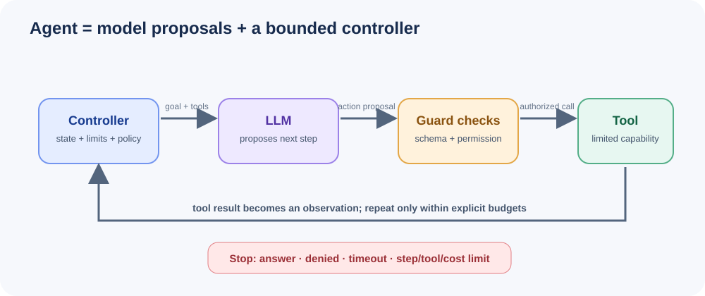

# Module 08: AI Agents & Tool Use

## What Are AI Agents?

An **AI agent** is a system that perceives its environment, reasons about what to do, and takes actions to achieve goals. Unlike a simple LLM call that produces text, an agent can interact with external tools, maintain state, and make decisions in a loop.

### The Perception → Reasoning → Action Loop



```
┌─────────────────────────────────────────────┐
│                  AGENT                       │
│                                              │
│  ┌────────────┐   ┌──────────┐   ┌────────┐ │
│  │ Perception │──▶│ Reasoning│──▶│ Action │ │
│  │ (Observe)  │◀──│ (Think)  │◀──│ (Do)   │ │
│  └────────────┘   └──────────┘   └────────┘ │
│       ▲                              │       │
│       └──────────────────────────────┘       │
│              (Environment)                    │
└─────────────────────────────────────────────┘
```

1. **Perception**: The agent observes the current state — user input, tool outputs, memory, environment signals.
2. **Reasoning**: The LLM processes observations and decides what to do next.
3. **Action**: The agent executes a tool call, makes an API request, or produces a final response.
4. **Loop**: The result of the action becomes a new observation, and the cycle repeats.

This loop continues until the agent determines it has enough information to produce a final answer, or a maximum number of iterations is reached.

---

## Agent Architectures

### ReAct (Reason + Act)

The most common agent pattern. The LLM alternates between reasoning (thinking out loud) and acting (calling tools).

```
Thought: I need to find the population of France.
Action: search("population of France 2024")
Observation: France has approximately 68 million people.
Thought: I now have the answer.
Final Answer: France has approximately 68 million people.
```

**Strengths**: Simple, debuggable, works well with any LLM that supports instruction following.

**Weaknesses**: Sequential — can only do one thing at a time. May loop if the LLM doesn't know when to stop.

### Plan-and-Execute

The agent first creates a plan, then executes each step.

```
Plan:
1. Search for recent AI papers
2. Extract key findings from top 3
3. Compare methodologies
4. Generate summary report

Executing step 1... Done.
Executing step 2... Done.
...
```

**Strengths**: Better for complex, multi-step tasks. Reduces redundant reasoning.

**Weaknesses**: Plans can become outdated. Less adaptive to changing conditions.

### Multi-Agent Systems

Multiple specialized agents collaborate to solve a problem.

```
┌──────────┐    ┌──────────┐    ┌──────────┐
│ Research │───▶│ Writer   │───▶│ Critic   │
│ Agent    │    │ Agent    │    │ Agent    │
└──────────┘    └──────────┘    └──────────┘
```

**Strengths**: Each agent focuses on what it does best. Scales to complex workflows.

**Weaknesses**: Coordination overhead. Harder to debug. Higher cost.

---

## Function Calling / Tool Use

Modern LLMs support **function calling** — the ability to output structured JSON that specifies which function to call and with what arguments.

### How It Works

1. **Define tools** as JSON schemas (name, description, parameters).
2. **Send query** to the LLM along with tool definitions.
3. **LLM decides** whether to call a tool or respond directly.
4. **If tool call**: Execute the function, return the result to the LLM.
5. **LLM synthesizes** the tool result into a final answer.

### API Comparison

| Feature | OpenAI | Claude (Anthropic) | Gemini (Google) |
|---------|--------|-------------------|-----------------|
| Field name | `tools` | `tools` | `tools` |
| Tool schema | JSON Schema | JSON Schema | JSON Schema |
| Parallel calls | Yes | Yes | Yes |
| Streaming | Yes | Yes | Yes |

---

## Memory Systems

Agents need memory to maintain context across interactions.

### Working Memory (Short-Term)
- The current conversation context
- Token-limited (typically 4K–128K tokens)
- Lost when the session ends

### Episodic Memory (Medium-Term)
- Summaries of past interactions
- Compressed representations of conversation history
- Retained across sessions

### Semantic Memory (Long-Term)
- Facts learned about the user or world
- Stored in a vector database
- Retrieved by relevance (similarity search)

```
┌─────────────────────────────────────┐
│           Memory Architecture        │
│                                      │
│  Working Memory (current context)    │
│         │                            │
│         ▼                            │
│  Episodic Memory (summaries)         │
│         │                            │
│         ▼                            │
│  Semantic Memory (vector store)      │
└─────────────────────────────────────┘
```

---

## Agent Frameworks

### LangChain
- Most popular LLM application framework
- Rich ecosystem: LangGraph, LangSmith, LangServe
- abstractions for chains, agents, tools, memory
- Best for: Rapid prototyping, complex chains

### LlamaIndex
- Focused on data ingestion and retrieval
- Excellent RAG (Retrieval-Augmented Generation)
- Agent capabilities built on top of data index
- Best for: Knowledge-intensive applications

### CrewAI
- Multi-agent orchestration
- Role-based agent definitions
- Built-in collaboration patterns
- Best for: Team-based agent workflows

### Building from Scratch
- Full control over every component
- No framework overhead or breaking changes
- Deeper understanding of how agents work
- Best for: Learning, production systems needing fine control

---

## Real-World Agent Use Cases

| Use Case | Description | Tools Needed |
|----------|-------------|--------------|
| **Research Assistant** | Finds, summarizes, and cites sources | Web search, PDF reader, citation manager |
| **Code Assistant** | Writes, tests, and debugs code | Code executor, file system, terminal |
| **Data Analyst** | Queries databases, creates visualizations | SQL engine, chart library, Python |
| **Customer Support** | Handles tickets, escalates when needed | Knowledge base, ticket system, email |
| **Personal Assistant** | Schedules, reminds, manages tasks | Calendar, email, task manager |
| **DevOps Agent** | Monitors, deploys, rollbacks on failure | Cloud APIs, monitoring tools, CI/CD |

---

## Agent Evaluation and Testing

Testing agents is harder than testing traditional software because:

1. **Non-deterministic**: Same input can produce different outputs.
2. **Multi-step**: Failures can cascade through the reasoning chain.
3. **Tool-dependent**: Tests need to mock or sandbox external tools.

### Evaluation Strategies

- **Unit tests**: Test individual tool functions in isolation.
- **Integration tests**: Test the agent with mocked LLM responses.
- **End-to-end tests**: Run the agent with real LLM calls against known benchmarks.
- **Human evaluation**: Have humans rate agent outputs on quality, accuracy, and safety.
- **Trajectory analysis**: Log every step and verify the reasoning chain is reasonable.

### Key Metrics

- **Task completion rate**: Does the agent achieve the goal?
- **Tool accuracy**: Does it call the right tools with correct arguments?
- **Efficiency**: How many steps does it take?
- **Safety**: Does it avoid harmful actions?
- **Cost**: How many tokens/API calls does it consume?

---

## Safety Considerations for Autonomous Agents

Autonomous agents pose unique risks because they can take real-world actions.

### Principle of Least Privilege
- Give agents only the tools they need
- Restrict file system access, network access, database permissions
- Use sandboxed execution environments

### Human-in-the-Loop
- Require confirmation for destructive actions
- Allow users to override or correct agent decisions
- Implement approval workflows for high-stakes operations

### Guardrails
- Validate tool inputs before execution
- Set maximum token budgets and iteration limits
- Implement rate limiting on API calls
- Log all actions for auditability

### Failure Modes to Watch
- **Hallucinated tools**: Agent calls tools that don't exist
- **Argument injection**: Malicious input causes unintended tool behavior
- **Infinite loops**: Agent keeps reasoning without producing an answer
- **Scope creep**: Agent exceeds its intended functionality
- **Data exfiltration**: Agent leaks sensitive data through tool outputs

---

## Module Structure

| # | File | Description |
|---|------|-------------|
| 1 | `README.md` | This guide |
| 2 | `function_calling.py` | OpenAI, Claude, and Gemini function calling patterns |
| 3 | `react_agent.py` | ReAct agent built from scratch |
| 4 | `multi_tool_agent.py` | Agent with tool registry and chaining |
| 5 | `agent_with_memory.py` | Agent with short-term, summary, and long-term memory |
| 6 | `langchain_agents.py` | LangChain agent examples and comparison |

### Prerequisites

```bash
pip install openai anthropic langchain langchain-openai langchain-anthropic chromadb
```

### Running the Examples

```bash
# Set API keys
export OPENAI_API_KEY="your-key"
export ANTHROPIC_API_KEY="your-key"

# Run individual modules
python function_calling.py
python react_agent.py
python multi_tool_agent.py
python agent_with_memory.py
python langchain_agents.py
```

---

## What's Next?

**Module 09: Advanced RAG** builds on the basic retrieval system in Module 05, covering hybrid search, reranking, graph retrieval, and iterative retrieval.

## Visual Deep Dive

Continue to **[Module 8 Deep Dive](deep-dive.md)** for tool contracts, controller architecture, agent state machines, memory types, and bounded autonomy.

---

## References

- [ReAct Paper](https://arxiv.org/abs/2210.03629) — Reasoning + Acting in Language Models
- [Toolformer Paper](https://arxiv.org/abs/2302.04761) — Language models can teach themselves to use tools
- [OpenAI Function Calling](https://platform.openai.com/docs/guides/function-calling)
- [Anthropic Tool Use](https://docs.anthropic.com/en/docs/build-with-claude/tool-use)
- [LangChain Agents](https://python.langchain.com/docs/modules/agents/)
- [CrewAI Documentation](https://docs.crewai.com/)
- [Agent Evaluation Guide](https://docs.smith.langchain.com/evaluation/agents)
