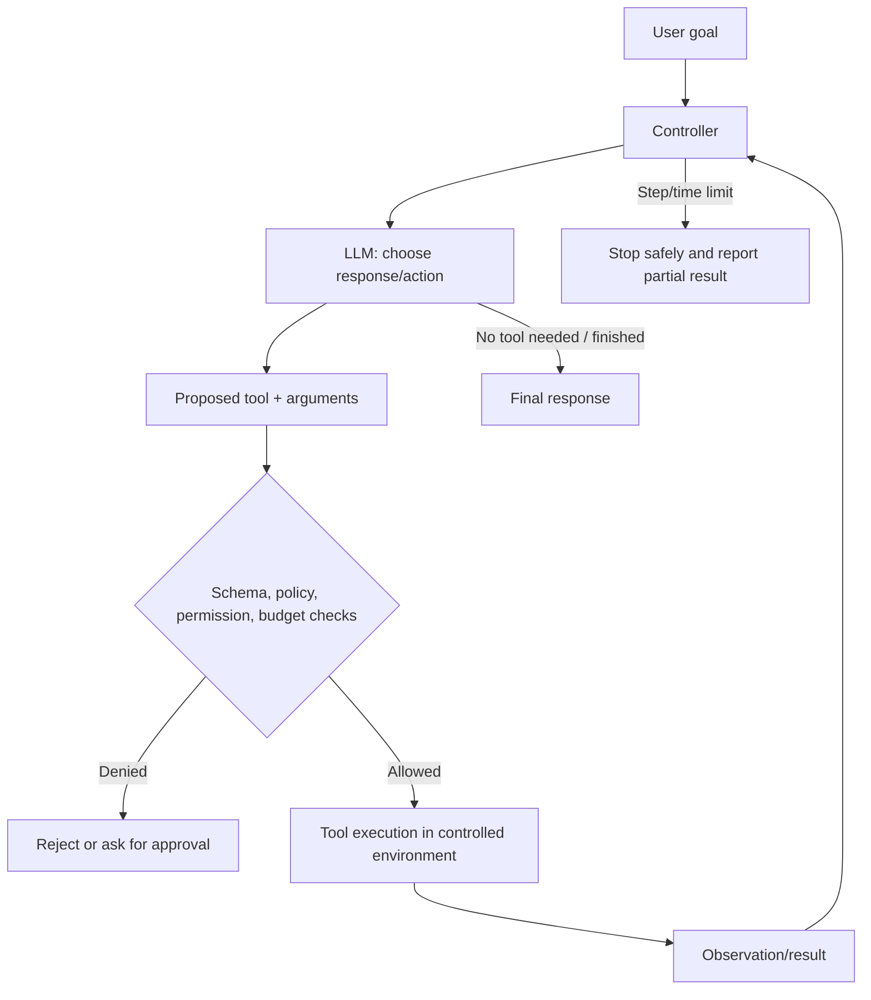

# Module 8 Deep Dive — Agents, Tools, State, and Control

An agent is a software loop that uses a model to select actions and uses program code to execute them. Agentic behavior is not a special property of an API call; it emerges from the controller, model, tools, state, and stopping rules working together.

## 1. Separate the model from the controller



The model proposes; the controller validates; a tool performs the operation. Do not allow a string generated by the model to become a shell command, SQL query, URL fetch, or payment action without independent checks.

## 2. Tool contracts

A useful tool definition documents:

- **Name and purpose:** one narrow responsibility.
- **Typed input schema:** required fields, allowed ranges, enums, maximum lengths.
- **Output contract:** structured result or explicit error.
- **Permissions:** what resources the tool can access.
- **Timeout and budget:** maximum runtime, requests, and data size.
- **Side effects:** whether it reads, writes, sends, deletes, or spends money.

Prefer tools such as `lookup_order(order_id)` over unrestricted `run_sql(query)`. Narrow capabilities are easier to test, authorize, and audit.

## 3. The agent loop is a state machine

```text
READY → ASK_MODEL → VALIDATE_PROPOSAL → EXECUTE_TOOL → APPEND_OBSERVATION
  ↑                                                     │
  └────────────────── continue if bounded ──────────────┘
                         ↓ finish / denied / timeout
                       RESPOND or STOP
```

Persist a structured trajectory: goal, tool name, validated arguments, result status, timestamps, and model/request identifiers. Avoid storing secrets or unnecessary personal data. State machines make timeout, retry, and failure behavior explicit rather than hidden in a loop.

## 4. Memory is not one thing

| Memory type | Example | Typical storage | Main risk |
|---|---|---|---|
| Working | Current task messages | Request/session state | Context growth and truncation |
| Episodic | Summary of prior sessions | Database or summary store | Stale or mistaken summaries |
| Semantic | User preference or verified fact | Structured store / vector index | Privacy, incorrect persistence |
| Procedural | Tool instructions and workflow policy | Versioned application config | Policy drift or unauthorized changes |

Give users visibility and control over persistent memory. Store provenance and timestamps; distinguish user-stated facts from model-inferred guesses. Retrieval from memory should respect access controls and deletion requests.

## 5. Bound autonomy

Set explicit limits for maximum turns, tool calls, tokens, wall-clock time, money, result sizes, and retry count. Require confirmation before irreversible or external actions. Use sandboxing for code execution and least-privilege credentials for integrations. A “helpful” agent with broad permissions is a high-impact security boundary.

## 6. Test trajectories, not only final prose

For known tasks, assert the expected action sequence or acceptable alternatives: the right tool, valid arguments, no forbidden action, and a correct final result. Mock tools for unit tests; run integration tests in isolated environments; evaluate end-to-end with a real, curated task set. Log and inspect loops, repeated calls, fabricated success claims, and tool failures.

## Check your understanding

1. Why should model-generated arguments be treated as untrusted input?
2. What is the difference between working memory and semantic memory?
3. Which checks should happen before a tool call that sends an email?
4. What would a trajectory test catch that a final-answer test might miss?

## Continue

Return to the [Module 8 overview](README.md), then continue to [Module 9: Advanced RAG](../09-advanced-rag/README.md).
