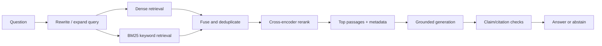

# Module 9 Deep Dive — Improving Retrieval with Evidence

Advanced RAG is a set of targeted interventions, not a checklist of fashionable components. Diagnose the error first, then choose the smallest technique that addresses it and measure the impact.

## 1. A retrieval stack



Do not add all stages blindly. Every stage adds latency, cost, configuration, and possible failure. Establish a baseline dataset and measure recall, precision, answer quality, latency, and spend before and after each change.

## 2. Sparse and dense retrieval complement each other

BM25 rewards lexical overlap and is strong for exact identifiers, product codes, names, and quoted terms. Dense retrieval can match related meanings even when wording differs. Hybrid search combines their ranked results; raw scores are often on different scales, so rank fusion (such as reciprocal rank fusion) can be safer than adding uncalibrated scores.

An illustrative RRF score is:

\[
\operatorname{RRF}(d)=\sum_{r\in\text{rankers}}\frac{1}{k+\operatorname{rank}_r(d)}
\]

The constant `k` dampens the effect of high ranks. Tune on a representative retrieval set rather than assuming a fixed weight works for all domains.

## 3. Retrieval then reranking

Bi-encoders embed the query and document separately for fast candidate retrieval. A cross-encoder reads query and candidate together and can provide a more nuanced relevance score, but is more expensive; therefore, rerank a modest candidate set rather than the whole corpus.

```text
large corpus --fast candidate search--> top 50 --deep reranker--> best 5
```

Inspect the ranked list. If the needed passage is absent from top 50, reranking cannot recover it. Improve parsing, chunking, filters, query formulation, or candidate recall first.

## 4. Query transformation patterns

- **Multi-query:** create diverse searches; merge and deduplicate. Helps terminology mismatch, but can add irrelevant candidates.
- **HyDE:** generate a hypothetical passage and retrieve near it. Useful for vocabulary mismatch; the hypothetical text is not evidence and must never be cited as a source.
- **Step-back:** retrieve broad background before querying details. Useful for questions that need a concept hierarchy.
- **Metadata filters:** constrain search by version, date, team, or access scope. Apply authorization in trusted code, not by asking the model to respect it.

## 5. Graph RAG and multi-hop questions

Graph-based retrieval can preserve relations across entities—e.g. “Which product is owned by the team that maintains service X?”—but entity extraction can be wrong, graph construction can lose nuance, and graph traversal can return too much. Validate extracted entities/edges against source spans, preserve provenance for each edge, and combine graph traversal with original text passages for grounding.

## 6. Agentic RAG

Iterative retrieval is useful when a question decomposes into subquestions or the first evidence set is clearly incomplete. The loop must have a stop rule, a query/call budget, and a final evidence sufficiency check. More retrieval attempts are not necessarily better; an agent can reinforce a mistaken assumption.

## 7. Multimodal documents

Tables, diagrams, and page layout may carry meaning that plain text extraction loses. Keep page coordinates and source IDs; use text extraction for searchable text and a vision model/OCR path when visual structure matters. Store extracted content with provenance and distinguish OCR/transcription confidence from source truth.

## 8. Evaluate in layers

| Layer | Question | Example measure |
|---|---|---|
| Ingestion | Did we preserve content and metadata? | Parse coverage / manual spot checks |
| Retrieval | Did relevant evidence appear near the top? | Recall@k, precision@k, MRR |
| Generation | Is the answer relevant and supported? | Human rubric / judge with references |
| Citations | Do cited spans support claims? | Citation precision and coverage |
| Operations | Is it fast, stable, and affordable? | p95 latency, error rate, cost/query |

Automated LLM judges are useful for triage but can be biased or inconsistent. Calibrate them against human judgments and inspect failure examples.

## Check your understanding

1. Why can a reranker not fix a missed candidate?
2. Which search approach is naturally strong for an exact SKU?
3. Why must HyDE-generated text not be presented as retrieved evidence?
4. Name one quality and one operational metric for a RAG pipeline.

## Continue

Return to the [Module 9 overview](README.md) and use its decision guide to pick one technique to evaluate.
