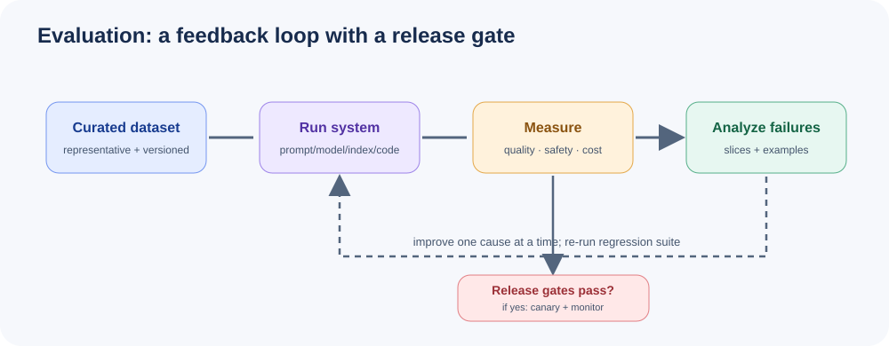

# Module 10: LLM Evaluation & Testing



> *"You can't improve what you can't measure."* — Peter Drucker

## Why Evaluation Matters

Deploying an LLM without rigorous evaluation is like shipping software without tests. Evaluation tells you:

- **Quality**: Does the model produce correct, fluent, helpful outputs?
- **Safety**: Does it refuse harmful requests? Does it hallucinate facts?
- **Latency**: Does it respond fast enough for your use case?
- **Cost**: Is the token usage acceptable at scale?

Without systematic evaluation, you're flying blind. Every prompt change, model swap, or fine-tuning run needs a way to know if things got better or worse.

## Evaluation Dimensions

| Dimension | What It Measures | Example Metrics |
|-----------|-----------------|-----------------|
| **Quality** | Accuracy, fluency, relevance | BLEU, ROUGE, human ratings |
| **Safety** | Toxicity, bias, harmfulness | Toxicity classifiers, red-teaming |
| **Latency** | Time to first token, throughput | p50/p95/p99 latency |
| **Cost** | Token usage, API spend | Cost per query, tokens/query |

## Automated Metrics

### Token Overlap Metrics

- **BLEU**: Precision-focused, measures n-gram overlap with reference. Good for translation.
- **ROUGE**: Recall-focused, measures n-gram overlap. Good for summarization.
- **Exact Match (EM)**: Binary correct/incorrect. Good for factual QA.

### Embedding-Based Metrics

- **Semantic Similarity**: Cosine similarity of sentence embeddings. Captures meaning even when words differ.

### Task-Specific Metrics

- **Code Pass@k**: Does generated code pass unit tests? (HumanEval)
- **Math Accuracy**: Does the final answer match? (GSM8K)
- **Multiple Choice Accuracy**: Did it pick the right option? (MMLU)

## LLM-as-Judge

Using a strong model (GPT-4) to evaluate outputs from other models:

```
Prompt: "Rate the following response on a scale of 1-5 for helpfulness..."
```

**Pros**: Captures nuance, understands context, scalable.
**Cons**: Expensive, can have its own biases, requires API access.

**Best practices**:
- Use rubrics, not vague instructions
- Evaluate one criterion at a time
- Include reference answers when available
- Check for position bias (swap order of candidates)

## Benchmarks

| Benchmark | Task | What It Tests |
|-----------|------|---------------|
| **MMLU** | Multiple choice across 57 subjects | Broad knowledge |
| **HumanEval** | Python code generation | Coding ability |
| **GSM8K** | Grade school math word problems | Reasoning |
| **MT-Bench** | Multi-turn conversations | Dialogue quality |
| **ARC** | Science reasoning | Domain knowledge + reasoning |

## Building Custom Evaluation Suites

1. **Collect test cases** from real user queries
2. **Define expected outputs** (exact, fuzzy, or rubric-based)
3. **Choose metrics** per test case type
4. **Run automated evals** first, human evals for edge cases
5. **Track results over time** to catch regressions

## Human Evaluation Design

- **Scoring rubrics**: Clear, anchored scales (1-5 with descriptions)
- **Inter-annotator agreement**: Cohen's kappa (2 raters), Fleiss' kappa (3+)
- **Disagreement resolution**: Discussion, majority vote, or expert adjudication

## Evaluation Frameworks

| Framework | Strength | Best For |
|-----------|----------|----------|
| **DeepEval** | Unit-test style evals | CI/CD integration |
| **LangSmith** | End-to-end tracing | Full pipeline debugging |
| **Phoenix (Arize)** | Observability + evals | Production monitoring |
| **RAGAS** | RAG-specific metrics | Retrieval-augmented generation |

## When to Use Which Approach

```
Need quick feedback?     → Automated metrics (BLEU, ROUGE, EM)
Need nuance?             → LLM-as-judge
Need ground truth?       → Benchmark datasets
Need real-world signal?  → Human evaluation
Need production insight? → LangSmith / Phoenix
Need CI/CD gate?         → DeepEval
```

## Module Structure

| File | Description |
|------|-------------|
| `llm_evaluation.py` | LLM-as-judge evaluation system |
| `benchmarks.py` | Standard benchmark runners (MMLU, HumanEval, GSM8K) |
| `custom_eval.py` | Build custom evaluation suites |
| `human_eval.py` | Human evaluation framework with agreement metrics |
| `eval_report.py` | Report generation and visualization |
| `README.md` | This file |

## Quick Start

```bash
pip install openai scikit-learn numpy pandas
python llm_evaluation.py      # LLM-as-judge demo
python benchmarks.py           # Benchmark evaluation
python custom_eval.py          # Custom eval suite
python human_eval.py           # Human eval framework
python eval_report.py          # Report generation
```

## Key Takeaways

1. **Automate first**, human-evaluate second
2. **No single metric** tells the whole story — use multiple
3. **Track metrics over time** to catch regressions
4. **LLM-as-judge is powerful** but needs careful design (rubrics, position balancing)
5. **Custom eval suites** built from real user data are more valuable than public benchmarks
6. **Human evaluation** is the gold standard but expensive — use it strategically

## Visual Deep Dive

Continue to **[Module 10 Deep Dive](deep-dive.md)** for dataset construction, metric selection, judge calibration, uncertainty, and release gates.
