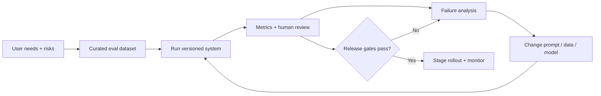

# Module 10 Deep Dive — Build an Evaluation Loop

Evaluation is a repeatable experiment that connects intended user outcomes to measurable evidence. It is not a single benchmark score and should cover both task success and unacceptable regressions.

## 1. Evaluation as a development loop

Version the dataset, prompts, model identifier, decoding parameters, retrieval index, and code. Otherwise a score change cannot be attributed to a specific system change.

## 2. Construct a useful dataset

Start from actual tasks and define a case schema: input, expected behavior, references/evidence, category, severity, and source. Include normal examples, boundary cases, ambiguous or missing information, long inputs, adversarial attempts, and known failure modes. Remove personal data that is not needed. Separate development examples from a final holdout set.

Avoid a dataset made only of easy questions or synthetic examples produced by the same model being evaluated. Document known limitations and re-review cases when product behavior changes.

## 3. Metrics answer different questions

- **Exact match / accuracy:** useful for labels and normalized short answers; intolerant of equivalent wording.
- **Precision / recall / F1:** useful when false positives and false negatives have different costs.
- **BLEU / ROUGE:** lexical overlap measures, not universal measures of meaning or factual correctness.
- **Semantic similarity:** captures related meaning, but can reward a fluent answer that misses a critical detail.
- **Task execution:** for code/tools, run tests or verify resulting state rather than judging the prose.
- **Latency/cost/safety:** operational and risk measures that belong beside quality metrics.

Choose metrics based on the decision being made. A high average can hide a severe failure subgroup; report slices by task, language, user segment, or risk category where appropriate.

## 4. LLM-as-judge: a rubric, not an oracle

Give the judge the task, evidence, response, and anchored criteria. Ask it to score one dimension at a time and provide a concise rationale tied to the rubric. Test for position bias by swapping candidate order; compare a sample with expert human ratings. Do not use a judge's unsupported confidence as ground truth.

For pairwise comparisons, randomize which response appears first and blind the judge to model identity. For high-impact decisions, require human review and document adjudication.

## 5. Uncertainty in measured scores

If measured accuracy is `p̂` on `n` independent cases, sampling uncertainty shrinks with larger and representative datasets. A rough standard error is `√(p̂(1−p̂)/n)`. Small test sets can make noisy changes look meaningful; report sample size and confidence intervals, and compare on the same cases.

When comparing two systems on identical examples, use paired analysis (for instance, count cases where A passes and B fails versus the reverse) rather than treating results as unrelated samples.

## 6. Release gates and regression suites

Set minimum thresholds for core quality and safety, and maximum budgets for latency/cost. Also create hard-fail cases for critical constraints such as “never invent a citation” or “never perform a write action without authorization.” Thresholds should reflect product risk and be agreed before looking at results.

## Check your understanding

1. Why is ROUGE not a direct measure of factuality?
2. What is position bias in pairwise LLM judging?
3. Why preserve a holdout set during prompt tuning?
4. Which would be a good hard-fail gate for a tool-using agent?

## Continue

Return to the [Module 10 overview](README.md), then build a small, versioned evaluation set for one project.
