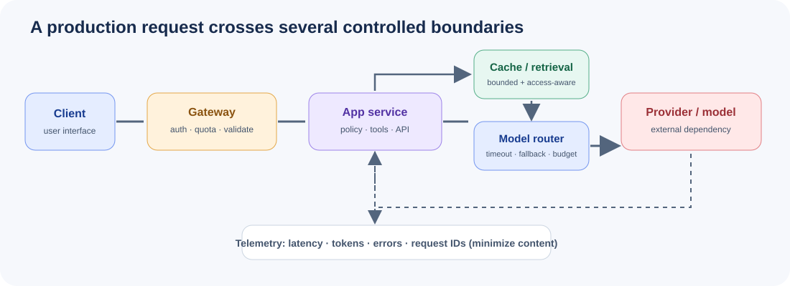

# Module 11: Deployment & Production



## From Prototype to Production

Moving an LLM application from prototype to production requires addressing concerns that notebooks ignore entirely:

| Concern | Prototype | Production |
|---------|-----------|------------|
| Reliability | Crashes are fine | 99.9% uptime SLA |
| Latency | Seconds OK | Sub-second p95 |
| Cost | Unlimited API keys | Budget constraints |
| Security | Trust all input | Validate + sanitize |
| Observability | Print statements | Structured logs + metrics |
| Scaling | One user | Thousands concurrent |
| Error handling | Try/except | Retry + fallback + circuit breaker |

### Key Shifts

1. **Input validation** — Never trust user input. Validate types, lengths, and content before sending to LLM APIs.
2. **Output validation** — LLM responses are non-deterministic. Parse, validate, and handle malformed outputs.
3. **Cost awareness** — Every token costs money. Implement budgets, routing, and compression.
4. **Graceful degradation** — When the primary model fails, fall back to cheaper alternatives or cached responses.
5. **Observability** — You cannot fix what you cannot measure. Log everything, track metrics, set alerts.

---

## LLM API Service Patterns

### Synchronous Pattern

Simple request-response. Blocks until the LLM returns.

```python
import openai

client = openai.OpenAI()

def chat(messages: list[dict]) -> str:
    response = client.chat.completions.create(
        model="gpt-4o",
        messages=messages,
        temperature=0.7,
    )
    return response.choices[0].message.content
```

**When to use:** Simple backends, internal tools, batch processing.

### Streaming Pattern

Returns tokens as they are generated. Better perceived latency.

```python
def chat_stream(messages: list[dict]):
    stream = client.chat.completions.create(
        model="gpt-4o",
        messages=messages,
        stream=True,
    )
    for chunk in stream:
        if chunk.choices[0].delta.content:
            yield chunk.choices[0].delta.content
```

**When to use:** User-facing chat interfaces, long responses.

### Async Pattern

Non-blocking. Handles many concurrent requests efficiently.

```python
import openai

client = openai.AsyncOpenAI()

async def chat_async(messages: list[dict]) -> str:
    response = await client.chat.completions.create(
        model="gpt-4o",
        messages=messages,
    )
    return response.choices[0].message.content
```

**When to use:** High-concurrency servers, microservices.

---

## FastAPI for LLM Services

FastAPI is ideal for LLM services because:

- **Async support** — Native `async/await` for non-blocking LLM calls.
- **Streaming** — `StreamingResponse` for token-by-token output.
- **Pydantic validation** — Automatic request/response validation.
- **OpenAPI docs** — Auto-generated API documentation.
- **Performance** — One of the fastest Python frameworks.

### Basic Structure

```python
from fastapi import FastAPI, HTTPException
from pydantic import BaseModel

app = FastAPI(title="LLM Service")

class ChatRequest(BaseModel):
    messages: list[dict]
    model: str = "gpt-4o"
    temperature: float = 0.7

class ChatResponse(BaseModel):
    content: str
    tokens_used: int

@app.post("/chat", response_model=ChatResponse)
async def chat(request: ChatRequest):
    # ... LLM call ...
    return ChatResponse(content="response", tokens_used=42)
```

---

## Rate Limiting and Retry Logic

### Why Rate Limit?

- LLM APIs have rate limits (RPM, TPM).
- Users can abuse your service.
- Cost control requires limiting usage.

### Exponential Backoff

When a request fails, wait increasingly longer before retrying:

```
Attempt 1: immediate
Attempt 2: wait 1s
Attempt 3: wait 2s
Attempt 4: wait 4s
Attempt 5: wait 8s (give up)
```

```python
import asyncio
import random

async def retry_with_backoff(func, max_retries=5, base_delay=1.0):
    for attempt in range(max_retries):
        try:
            return await func()
        except Exception as e:
            if attempt == max_retries - 1:
                raise
            delay = base_delay * (2 ** attempt) + random.uniform(0, 1)
            await asyncio.sleep(delay)
```

### Circuit Breaker

When failures exceed a threshold, stop sending requests temporarily:

```python
class CircuitBreaker:
    def __init__(self, failure_threshold=5, recovery_timeout=60):
        self.failure_count = 0
        self.failure_threshold = failure_threshold
        self.recovery_timeout = recovery_timeout
        self.state = "closed"  # closed = normal, open = blocking
        self.last_failure_time = None

    def record_failure(self):
        self.failure_count += 1
        if self.failure_count >= self.failure_threshold:
            self.state = "open"
            self.last_failure_time = time.time()

    def allow_request(self):
        if self.state == "closed":
            return True
        if time.time() - self.last_failure_time > self.recovery_timeout:
            self.state = "half-open"
            return True
        return False
```

---

## Response Caching

Caching LLM responses saves money and reduces latency.

### Exact Match Cache

Hash the request (model + messages + parameters) and store the response.

```python
import hashlib
import json

def cache_key(model: str, messages: list[dict], **kwargs) -> str:
    content = json.dumps({"model": model, "messages": messages, **kwargs}, sort_keys=True)
    return hashlib.sha256(content.encode()).hexdigest()
```

**Pros:** Fast, deterministic, no false positives.
**Cons:** Misses semantically similar requests.

### Semantic Cache

Embed the prompt, find similar cached prompts by cosine similarity.

```python
import numpy as np

class SemanticCache:
    def __init__(self, threshold=0.95):
        self.cache = []  # (embedding, response)
        self.threshold = threshold

    def get(self, query_embedding):
        if not self.cache:
            return None
        similarities = [
            np.dot(query_embedding, emb) / (np.linalg.norm(query_embedding) * np.linalg.norm(emb))
            for emb, _ in self.cache
        ]
        best_idx = np.argmax(similarities)
        if similarities[best_idx] >= self.threshold:
            return self.cache[best_idx][1]
        return None
```

**Pros:** Catches paraphrased requests.
**Cons:** Slower, may have false positives.

---

## Cost Optimization

### Model Routing

Use cheaper models for simple tasks, expensive models for complex ones:

```python
def route_model(prompt: str) -> str:
    if is_simple(prompt):
        return "gpt-4o-mini"  # $0.15/1M input tokens
    elif is_complex(prompt):
        return "gpt-4o"      # $2.50/1M input tokens
    else:
        return "gpt-4o"      # Default to capable model
```

### Prompt Compression

Remove redundancy from conversation history:

```python
def compress_history(messages: list[dict], max_tokens: int = 2000) -> list[dict]:
    """Keep system prompt + recent messages, summarize older ones."""
    system = [m for m in messages if m["role"] == "system"]
    history = [m for m in messages if m["role"] != "system"]

    if count_tokens(history) <= max_tokens:
        return messages

    recent = history[-4:]  # Keep last 2 exchanges
    older = history[:-4]

    summary = summarize(older)  # Use LLM to summarize
    return system + [{"role": "user", "content": f"Previous context: {summary}"}] + recent
```

### Token Budgeting

Set hard limits on token usage per request and per user:

```python
class TokenBudget:
    def __init__(self, daily_limit=100000, monthly_limit=1000000):
        self.daily_usage = {}
        self.monthly_usage = {}
        self.daily_limit = daily_limit
        self.monthly_limit = monthly_limit

    def can_use(self, user_id: str, tokens: int) -> bool:
        daily = self.daily_usage.get(user_id, 0)
        monthly = self.monthly_usage.get(user_id, 0)
        return daily + tokens <= self.daily_limit and monthly + tokens <= self.monthly_limit
```

---

## Monitoring and Observability

### What to Track

| Metric | Why |
|--------|-----|
| Request latency | User experience |
| Token usage | Cost management |
| Error rate | Reliability |
| Cache hit rate | Efficiency |
| Cost per request | Budget tracking |
| Model distribution | Routing effectiveness |

### Structured Logging

```python
import structlog

logger = structlog.get_logger()

logger.info("llm_request",
    model="gpt-4o",
    tokens_input=150,
    tokens_output=300,
    latency_ms=1200,
    cost_usd=0.0025,
    user_id="user_123",
)
```

### Metrics (Prometheus-compatible)

```python
from prometheus_client import Counter, Histogram, Gauge

REQUEST_COUNT = Counter("llm_requests_total", "Total requests", ["model", "status"])
REQUEST_LATENCY = Histogram("llm_request_duration_seconds", "Request latency", ["model"])
TOKEN_USAGE = Counter("llm_tokens_total", "Total tokens", ["model", "type"])
ACTIVE_REQUESTS = Gauge("llm_active_requests", "Currently processing requests")
```

---

## Docker Deployment

### Dockerfile

```dockerfile
FROM python:3.11-slim

WORKDIR /app

COPY requirements.txt .
RUN pip install --no-cache-dir -r requirements.txt

COPY . .

EXPOSE 8000

CMD ["uvicorn", "api_server:app", "--host", "0.0.0.0", "--port", "8000"]
```

### docker-compose.yml

```yaml
version: "3.9"
services:
  api:
    build: .
    ports:
      - "8000:8000"
    environment:
      - OPENAI_API_KEY=${OPENAI_API_KEY}
      - REDIS_URL=redis://redis:6379
    depends_on:
      - redis
    deploy:
      replicas: 3
      resources:
        limits:
          memory: 512M

  redis:
    image: redis:7-alpine
    ports:
      - "6379:6379"

  prometheus:
    image: prom/prometheus
    volumes:
      - ./prometheus.yml:/etc/prometheus/prometheus.yml
    ports:
      - "9090:9090"

  grafana:
    image: grafana/grafana
    ports:
      - "3000:3000"
```

---

## Scaling Strategies

### Horizontal Scaling

Add more instances behind a load balancer:

```
                    ┌──────────────┐
                    │ Load Balancer│
                    └──────┬───────┘
              ┌────────────┼────────────┐
              │            │            │
         ┌────┴────┐ ┌────┴────┐ ┌────┴────┐
         │ API #1  │ │ API #2  │ │ API #3  │
         └─────────┘ └─────────┘ └─────────┘
```

**Pros:** Linear scaling, fault tolerance.
**Cons:** Requires stateless design, shared cache.

### Vertical Scaling

Use a bigger machine with more CPU/RAM/GPU.

**Pros:** Simple, no distributed complexity.
**Cons:** Hardware limits, single point of failure.

### Queue-Based Scaling

Decouple request ingestion from processing:

```
Client → API (accepts) → Queue → Worker Pool → Response
```

**Pros:** Burst handling, priority queuing, retry logic.
**Cons:** Added complexity, eventual consistency.

---

## Error Handling and Fallback Chains

```python
FALLBACK_CHAIN = ["gpt-4o", "gpt-4o-mini", "claude-3-haiku"]

async def chat_with_fallback(messages: list[dict]) -> str:
    for model in FALLBACK_CHAIN:
        try:
            return await call_model(model, messages)
        except RateLimitError:
            continue
        except TimeoutError:
            continue
        except Exception as e:
            logger.error("model_failed", model=model, error=str(e))
            continue

    # All models failed — return cached or default response
    cached = cache.get(messages)
    if cached:
        return cached
    raise ServiceUnavailable("All models failed and no cache available")
```

---

## Security

### Input Validation

```python
from pydantic import BaseModel, validator

class ChatRequest(BaseModel):
    messages: list[dict]
    max_tokens: int = 4096

    @validator("messages")
    def validate_messages(cls, v):
        if len(v) > 100:
            raise ValueError("Too many messages (max 100)")
        for msg in v:
            if len(msg.get("content", "")) > 50000:
                raise ValueError("Message too long (max 50k chars)")
        return v
```

### Prompt Injection Prevention

```python
INJECTION_PATTERNS = [
    "ignore previous instructions",
    "you are now",
    "system: ",
    "ADMIN OVERRIDE",
]

def check_injection(text: str) -> bool:
    lower = text.lower()
    return any(pattern in lower for pattern in INJECTION_PATTERNS)
```

### API Key Management

```python
import os

# NEVER hardcode keys
API_KEY = os.environ["OPENAI_API_KEY"]  # From environment

# Rotate keys regularly
# Use secret managers (AWS Secrets Manager, HashiCorp Vault)
# Log key usage but never log the key itself
```

---

## Testing LLM Services

### Unit Tests

```python
import pytest

def test_chat_request_validation():
    with pytest.raises(ValidationError):
        ChatRequest(messages="not a list")

def test_cache_key_deterministic():
    key1 = cache_key("gpt-4o", [{"role": "user", "content": "hi"}])
    key2 = cache_key("gpt-4o", [{"role": "user", "content": "hi"}])
    assert key1 == key2
```

### Integration Tests

```python
import httpx

@pytest.mark.asyncio
async def test_chat_endpoint():
    async with httpx.AsyncClient(app=app) as client:
        response = await client.post("/chat", json={
            "messages": [{"role": "user", "content": "Say hello"}],
        })
        assert response.status_code == 200
        assert "content" in response.json()
```

### Load Tests

```python
import asyncio
import httpx

async def load_test(num_requests=100):
    async with httpx.AsyncClient(app=app) as client:
        tasks = [
            client.post("/chat", json={
                "messages": [{"role": "user", "content": f"Test {i}"}],
            })
            for i in range(num_requests)
        ]
        responses = await asyncio.gather(*tasks, return_exceptions=True)
        successes = sum(1 for r in responses if not isinstance(r, Exception))
        print(f"Success rate: {successes}/{num_requests}")
```

---

## Module Structure

| File | Description |
|------|-------------|
| `README.md` | This guide — comprehensive overview of LLM deployment |
| `api_server.py` | FastAPI LLM service with all endpoints |
| `streaming_server.py` | SSE streaming implementation |
| `rate_limiter.py` | Rate limiting, circuit breaker, retry logic |
| `caching.py` | Exact match + semantic response caching |
| `monitoring.py` | Structured logging, metrics, dashboard data |
| `docker_setup.py` | Docker configuration generator |
| `cost_optimizer.py` | Token optimization, model routing, budgeting |

---

## Running This Module

```bash
# Install dependencies
pip install fastapi uvicorn openai pydantic structlog prometheus-client httpx tiktoken numpy redis

# Run the API server
python api_server.py

# Run the streaming server
python streaming_server.py

# Generate Docker configs
python docker_setup.py

# Run with Docker
docker-compose up --build

# Run cost optimizer demo
python cost_optimizer.py
```

## Visual Deep Dive

Continue to **[Module 11 Deep Dive](deep-dive.md)** for latency budgets, failure handling, cost modeling, privacy-aware telemetry, and staged rollout.
