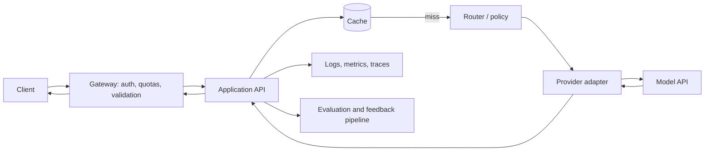

# Module 11 Deep Dive — Operating LLM Features in Production

Production readiness means controlling failure, latency, spend, privacy, and changes—not merely exposing a `/chat` endpoint. This lesson maps user experience to service architecture and operational controls.

## 1. Reference architecture



Keep provider access behind an adapter so model changes, retries, and telemetry are consistent. Keep authorization and business rules in deterministic application code. Do not allow cache keys or logs to accidentally expose sensitive content.

## 2. Latency budgets

Decompose end-to-end latency into validation, cache lookup, retrieval, provider time-to-first-token, generation, and network delivery. Track p50 and tail percentiles (p95/p99); averages hide slow users. Streaming improves time-to-first-token for long outputs, while total completion time can remain similar.

```text
request latency = gateway + application + retrieval + model + response delivery
```

Set a deadline and pass the remaining time to downstream operations. A timeout after the provider has begun work can still incur cost; cancellation support varies by client/provider.

## 3. Reliability and degradation

Use bounded retries with exponential backoff and jitter for transient failures. Honor `Retry-After` where available. Use circuit breakers to prevent repeated calls to a failing dependency. Define fallbacks carefully: cheaper model, cached response, partial response, or explicit service-unavailable message. Never silently present stale cached output as current without a freshness policy.

Retries can duplicate side effects. For writes, use idempotency and explicit action state. Avoid retry storms by combining limits, jitter, and queues where appropriate.

## 4. Cost and capacity model

Estimate request cost from input/output tokens and current model pricing; then multiply by traffic scenarios and include retries, embeddings, reranking, and background jobs. Measure actual usage, cache hit rate, per-user usage, and cost by feature. Route simple tasks to cheaper models only after quality evaluation. Token compression must preserve relevant meaning; measure both token savings and output quality.

## 5. Security and privacy controls

- Authenticate users and enforce per-user authorization before retrieval or tool execution.
- Set input/output size limits and validate structured requests.
- Store secrets outside source control; rotate and scope provider credentials.
- Minimize prompt, completion, and trace retention; redact sensitive fields.
- Avoid logging full message bodies by default; define retention and access policies.
- Treat external content and model output as untrusted; validate before actions.
- Threat-model prompt injection, data leakage, denial of service, and unsafe tool use.

## 6. Observability without over-collecting

Capture request ID, model/version, prompt-template version, timestamps, token usage, cache outcome, retrieval IDs, tool names, status, and safe error categories. Use traces to follow one request across components. Establish SLOs for availability and latency, and alerts for error spikes, spend anomalies, queue growth, and quality regression. Observability must be designed alongside privacy—not by retaining all user content indefinitely.

## 7. Rollout strategy

```text
offline evaluation → staging/synthetic traffic → canary → gradual rollout
       ↑                                            │
       └──────── rollback if quality/SLO gates fail ┘
```

Version prompts and model configuration. Use canaries or shadow traffic to compare behavior before broad release. Have a tested rollback path and monitor user outcomes after deployment; offline benchmarks do not cover every production distribution shift.

## Check your understanding

1. Why are p95/p99 latency more useful than only average latency?
2. What does a circuit breaker protect against?
3. Why can retries be dangerous for a tool that sends a payment?
4. Which telemetry helps debug quality without retaining full private prompts?

## Continue

Return to the [Module 11 overview](README.md) and run the examples locally before exposing any service publicly.
