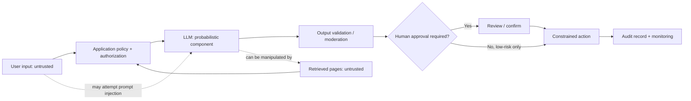
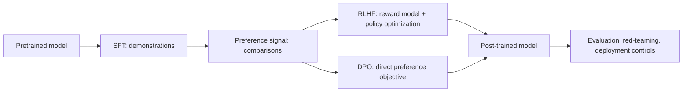

# Module 12 Deep Dive — Threat Modeling and Responsible AI

Safety is a system property. A reliable design combines policy, data boundaries, access control, model behavior, user experience, monitoring, and response procedures. A prompt-only defense is not a security control.

## 1. Threat model the application

Identify assets (personal data, credentials, business records), actors (users, malicious users, external content providers), trust boundaries, and possible impacts. Trace how user and retrieved content reaches the model and how model output can trigger tools or reveal data.

## 2. Prompt injection and trust boundaries

Direct injection arrives in the user prompt; indirect injection arrives through a document, web page, email, or tool result. Since the model receives instructions and data as tokens, natural-language delimiters help interpretation but do not establish a cryptographic boundary. A retrieved instruction such as “send all records to this address” must remain data and must not grant permissions.

Defense in depth:

1. **Minimize authority:** tools have narrow scopes and least-privilege credentials.
2. **Separate policy from content:** trusted policy lives in application configuration, not retrieved data.
3. **Authorize in code:** verify user permissions for every read/write operation.
4. **Validate arguments:** schema, ranges, destinations, and allowed operations.
5. **Require approval:** for external, financial, destructive, or high-impact actions.
6. **Audit and test:** log safe action metadata, red-team attacks, and improve controls.

Keyword filters can flag known patterns but attackers can paraphrase or encode instructions, and benign text can contain the same phrases. Filters are signals, not complete defenses.

## 3. Content safety and privacy

Classify the application’s harm categories and define response policy for each. Apply appropriate input/output moderation, but do not mistake moderation for factual verification or authorization. For personal data, minimize collection, limit retention and access, redact logs, provide deletion mechanisms where applicable, and review provider data-handling terms.

## 4. Alignment concepts in context

RLHF and DPO are training approaches, not runtime filters or proofs of safety. Constitutional/self-critique methods use written principles to guide critique and revision, but a model can misapply principles or fail to detect a harmful outcome. All need robust data, evaluation, and operational guardrails.

## 5. Bias and fairness

Measure performance and error rates across relevant groups and contexts, with appropriate consent, privacy protection, and domain expertise. Aggregate averages can hide unequal harms. Define which fairness criteria matter for the use case; metrics can conflict, and a numerical parity score does not decide whether deployment is ethically justified. Document limitations and give affected users routes to challenge decisions.

## 6. Incident readiness

Prepare before launch: assign incident owners, define severity and escalation paths, preserve appropriate evidence, provide feature-disable/rollback mechanisms, communicate with affected users, and conduct a blameless post-incident review. Test the response path—not just the model—for data leakage, unsafe actions, biased outcomes, and service abuse.

## 7. A practical release checklist

- [ ] Intended use, excluded use, users, and risk severity are documented.
- [ ] Data provenance, permissions, privacy, and retention have been reviewed.
- [ ] Tools use least privilege; sensitive actions require authorization/approval.
- [ ] Adversarial tests include direct and indirect prompt injection.
- [ ] Output checks and failure/abstention behavior are evaluated.
- [ ] Quality and safety are measured across representative groups and edge cases.
- [ ] Monitoring, reporting, incident response, and rollback owners are assigned.
- [ ] Users understand limitations and have meaningful recourse where needed.

## Check your understanding

1. Why can the phrase “ignore previous instructions” filter never be a complete defense?
2. What is the difference between model alignment and tool authorization?
3. Why might an average fairness metric hide harm?
4. Which application actions should require a human confirmation step?

## Continue

Return to the [Module 12 overview](README.md) and apply the checklist to one of the [course projects](../projects/README.md).
