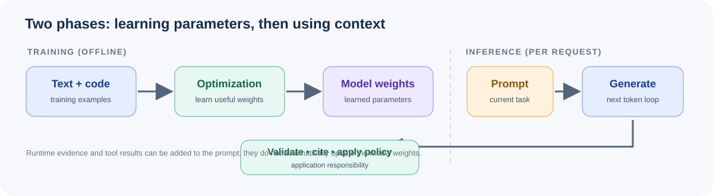

# Learn LLMs — A Complete Practical Course

> From zero to building real AI applications with Large Language Models.


---

## What Is This?

This is a **free, open-source course** on Large Language Models (LLMs) — designed for everyone from complete beginners to developers who want to build production-grade AI apps.

No fluff. Just clean explanations, working code, and real examples.

**12 modules. 5 projects. 60+ code files. From zero to production.**

> **Want all the core concepts in one place?** Start with the [Complete LLM Study Guide](./LLM_STUDY_GUIDE.md), a sequential reference covering model foundations, Transformers, training, prompting, RAG, fine-tuning, agents, evaluation, deployment, and safety.

---

## Course Roadmap



```
📦 LLMs/
┣ 📂 01-introduction              → What are LLMs? How do they work?
┣ 📂 02-transformer-architecture  → How transformers work under the hood
┣ 📂 02-prompt-engineering        → Prompt engineering (Module 3)
┣ 📂 03-llm-apis                  → Calling hosted and local models (Module 4)
┣ 📂 04-rag                       → Retrieval-augmented generation (Module 5)
┣ 📂 05-fine-tuning               → Fine-tuning (Module 6)
┣ 📂 07-advanced-prompting        → Self-consistency, Tree-of-Thought, ReAct
┣ 📂 08-ai-agents                 → Tool-using agents and controlled autonomy
┣ 📂 09-advanced-rag              → Reranking, hybrid search, graph RAG
┣ 📂 10-evaluation                → Evaluate and test LLM systems
┣ 📂 11-deployment                → Operate LLM applications in production
┣ 📂 12-safety-ethics             → Safety, alignment, and responsible AI
┗ 📂 projects/                    → 5 end-to-end real-world projects
```

The first six lessons retain the repository’s original directory names; the displayed module numbers describe the course sequence. Each module overview links to a visual deep-dive lesson.

---

## Who Is This For?

| Profile | What You'll Learn |
|---------|-------------------|
| **Beginners** | What LLMs are, how to prompt them, use APIs |
| **Developers** | Build RAG pipelines, integrate LLM APIs into apps |
| **ML Engineers** | Fine-tune models, evaluate outputs, go to production |
| **Tech Leads** | Deploy LLM services, optimize costs, ensure safety |

---

## Modules

### Module 1 — Introduction to LLMs

> *Perfect for beginners. No code required.*

- What is an LLM?
- How does training work? (Tokens, transformers, attention)
- Famous models: GPT-4, Claude, Gemini, Mistral, LLaMA
- Key concepts: Temperature, context window, hallucinations

📁 [`01-introduction/`](./01-introduction/README.md)

---

### Module 2 — Transformer Architecture

> *Understand what's actually happening inside LLMs.*

- Tokenization & embeddings
- Queries, Keys, Values — how attention works
- Multi-head attention with math + diagrams
- Feed-forward networks, residuals, layer norm
- Build a mini GPT from scratch (~150 lines of PyTorch)

📁 [`02-transformer-architecture/`](./02-transformer-architecture/README.md)

---

### Module 3 — Prompt Engineering

> *The skill that 10x's your LLM output quality.*

- Zero-shot, few-shot, chain-of-thought prompting
- Role prompting & system prompts
- Prompt templates & reusability
- Common mistakes and how to fix them

📁 [`02-prompt-engineering/`](./02-prompt-engineering/README.md)

---

### Module 4 — LLM APIs

> *Connect your apps to powerful AI models.*

- OpenAI API (GPT-4o, GPT-3.5)
- Anthropic Claude API
- Google Gemini API
- Open-source models via Ollama & HuggingFace
- Building a terminal chatbot

📁 [`03-llm-apis/`](./03-llm-apis/README.md)

---

### Module 5 — RAG (Retrieval Augmented Generation)

> *Give your LLM access to your own data.*

- Why RAG? The problem with LLM memory
- Embeddings & vector databases (FAISS, Pinecone, ChromaDB)
- Build a RAG pipeline from scratch
- Chat with your PDF

📁 [`04-rag/`](./04-rag/README.md)

---

### Module 6 — Fine-Tuning LLMs

> *Train a model on your own data.*

- When to fine-tune vs. prompt engineer vs. RAG
- Preparing your dataset (JSONL format)
- Fine-tuning with OpenAI & HuggingFace
- Evaluating your fine-tuned model

📁 [`05-fine-tuning/`](./05-fine-tuning/README.md)

---

### Module 7 — Advanced Prompting

> *Master advanced reasoning techniques.*

- Self-Consistency (multiple reasoning paths, majority vote)
- Tree-of-Thought (branching reasoning)
- ReAct (Reasoning + Acting interleaved)
- Least-to-Most, Skeleton-of-Thought
- Automatic prompt optimization
- Prompt chaining for complex workflows

📁 [`07-advanced-prompting/`](./07-advanced-prompting/README.md)

---

### Module 8 — AI Agents & Tool Use

> *Build autonomous AI systems that take action.*

- Function calling / Tool use (OpenAI, Claude)
- ReAct agent from scratch
- Multi-tool agent with registry pattern
- Memory systems (short-term, long-term, episodic)
- LangChain agent frameworks

📁 [`08-ai-agents/`](./08-ai-agents/README.md)

---

### Module 9 — Advanced RAG

> *Production-grade retrieval augmented generation.*

- Advanced chunking (semantic, recursive, document-aware)
- Reranking with cross-encoders
- Hybrid search (BM25 + vector)
- Graph RAG with knowledge graphs
- Agentic RAG (self-reflecting pipelines)
- Multimodal RAG (images + text)
- RAG evaluation with RAGAS

📁 [`09-advanced-rag/`](./09-advanced-rag/README.md)

---

### Module 10 — LLM Evaluation & Testing

> *You can't improve what you can't measure.*

- LLM-as-judge evaluation
- Standard benchmarks (MMLU, HumanEval, GSM8K)
- Custom evaluation suites
- Human evaluation frameworks
- Evaluation reports and analysis

📁 [`10-evaluation/`](./10-evaluation/README.md)

---

### Module 11 — Deployment & Production

> *Ship LLM apps that scale.*

- FastAPI LLM services with streaming
- Rate limiting and cost control
- Response caching (exact + semantic)
- Monitoring and observability
- Docker deployment
- Cost optimization and model routing

📁 [`11-deployment/`](./11-deployment/README.md)

---

### Module 12 — AI Safety & Ethics

> *Build AI responsibly.*

- Prompt injection attacks and defenses
- Jailbreaking techniques and mitigations
- Content filtering and safety layers
- Alignment (RLHF, Constitutional AI, DPO)
- Bias detection and mitigation
- Responsible AI development checklist

📁 [`12-safety-ethics/`](./12-safety-ethics/README.md)

---

## Projects

Apply everything you've learned in 5 real-world projects:

| # | Project | Description | Skills Used |
|---|---------|-------------|-------------|
| 1 | [**RAG Chatbot**](./projects/01-rag-chatbot/) | Chat with any PDF collection | RAG, ChromaDB, FastAPI |
| 2 | [**Code Review Agent**](./projects/02-code-review-agent/) | AI-powered code review | Agents, Tool Use, ReAct |
| 3 | [**ContextIQ — Document Q&A**](./projects/03-document-qa/) | Citation-first document Q&A web app | RAG, BM25, Streamlit, Evaluation |
| 4 | [**Customer Support Bot**](./projects/04-customer-support-bot/) | Intent-aware support automation | Fine-tuning, RAG, Classification |
| 5 | [**Research Assistant**](./projects/05-research-assistant/) | Research paper analysis agent | Agents, Extraction, Summarization |

---

## Learning Paths

### Beginner (Modules 1-4)
Start here if you're new to LLMs. You'll understand what they are, how they work, and how to use them via APIs.

### Intermediate (Modules 5-7)
Build real applications with RAG, fine-tuning, and advanced prompting techniques.

### Advanced (Modules 8-12)
Master agents, evaluation, deployment, and safety for production systems.

### Full Course (All 12 Modules + Projects)
Complete coverage from concepts to production. Recommended for serious practitioners.

### Visual and Deep-Dive Lessons

Start with the [Complete LLM Study Guide](./LLM_STUDY_GUIDE.md) for a single, connected learning path. Each module also includes a companion lesson with rendered diagrams, expanded explanations, worked reasoning, common failure modes, and knowledge checks. Start from a module overview and follow its **Visual Deep Dive** link. Browse the [diagram gallery](./assets/diagrams/README.md) or look up terminology in the [LLM systems glossary](./GLOSSARY.md).

---

## Quick Start

```bash
# Clone the repo
git clone https://github.com/RDrahul123/LLMs.git
cd LLMs

# Install Python dependencies
pip install -r requirements.txt

# Set your API keys
cp .env.example .env
# → Edit .env and add your keys

# Start with Module 1
cd 01-introduction
# Read the README.md
```

---

## Course Website

This repository includes a responsive, searchable course website with guided navigation, rendered diagrams, a dark-only visual theme, and browser-local reading progress. The existing Markdown lessons and code remain the source of truth.

```bash
python -m pip install -r course_site/requirements.txt
python course_site/prepare_docs.py
mkdocs serve
```

Deployment instructions for **GitHub Pages, Netlify, Vercel, and Docker-based hosts** are in [`course_site/README.md`](./course_site/README.md). GitHub Pages deployment is automated through the `Deploy course website` workflow.

---

## Prerequisites

- Python 3.9+
- Basic Python knowledge (for code modules)
- API keys: [OpenAI](https://platform.openai.com/) | [Anthropic](https://console.anthropic.com/) | [Google](https://aistudio.google.com/) *(free tiers available)*
- For local models: [Ollama](https://ollama.ai/) (optional, free)

---

## Repository Structure

```
LLMs/
├── 01-introduction/           # What are LLMs?
├── 02-transformer-architecture/  # How transformers work
├── 02-prompt-engineering/     # Prompt engineering (Module 3)
├── 03-llm-apis/               # LLM APIs (Module 4)
├── 04-rag/                    # RAG (Module 5)
├── 05-fine-tuning/            # Fine-tuning (Module 6)
├── 07-advanced-prompting/     # Advanced reasoning techniques
├── 08-ai-agents/              # Autonomous agents
├── 09-advanced-rag/           # Production RAG
├── 10-evaluation/             # Testing & evaluation
├── 11-deployment/             # Production deployment
├── 12-safety-ethics/          # Safety & responsibility
├── projects/                  # 5 end-to-end projects
├── assets/diagrams/           # Reusable SVG course diagrams
├── scripts/                   # Course documentation checks
├── GLOSSARY.md                 # Key terms and distinctions
├── requirements.txt           # Python dependencies
├── .env.example               # API key template
└── README.md                  # This file
```

---

## Contributing

Contributions are welcome! Found a bug, have a better example, or want to add a new module?

1. Fork the repo
2. Create a branch: `git checkout -b feature/your-idea`
3. Commit and push
4. Open a Pull Request

See [`CONTRIBUTING.md`](./CONTRIBUTING.md) for details.

---

## License

MIT License — free to use, share, and build on.

---

## Star This Repo

If this helped you, give it a star! It helps others find it.

---

*Made with love to make AI education accessible to everyone.*

## Check the Course Files

From the repository root, run the lightweight checker to verify local Markdown links, SVG XML, and Python syntax without installing the course's optional ML dependencies:

```bash
python scripts/check_course_docs.py
```
