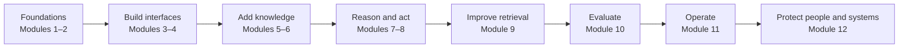

# Course Diagram Gallery

The course uses Mermaid diagrams (rendered directly by GitHub) and hand-authored SVG illustrations. SVGs are vector graphics, so they stay crisp when zoomed or printed. Each image has an accessible title and description in its source.

## Gallery

| Diagram | Main idea | Used in |
|---|---|---|
| [LLM lifecycle](llm-lifecycle.svg) | Training learns weights; inference combines weights and request context | [Module 1](../../01-introduction/README.md), [Module 4](../../03-llm-apis/README.md), root guide |
| [Transformer block](transformer-block.svg) | Residual paths, attention, and causal visibility | [Module 2](../../02-transformer-architecture/README.md) |
| [RAG pipeline](rag-pipeline.svg) | Separate indexing and query-time paths, then verify citations | [Module 5](../../04-rag/README.md), [Module 9](../../09-advanced-rag/README.md) |
| [Agent loop](agent-loop.svg) | The controller validates model-proposed actions before tools run | [Module 8](../../08-ai-agents/README.md) |
| [Evaluation loop](evaluation-loop.svg) | Measure, inspect failures, improve, and gate releases | [Module 10](../../10-evaluation/README.md) |
| [Production architecture](production-architecture.svg) | Requests cross authentication, application, provider, and telemetry boundaries | [Module 11](../../11-deployment/README.md) |
| [Safety defense in depth](safety-defense.svg) | Multiple safeguards surround an untrusted probabilistic component | [Module 12](../../12-safety-ethics/README.md) |

## Reading diagrams accurately

- Arrows show one common data/control flow, not every possible implementation.
- A model-generated answer or score is not automatically verified evidence.
- Application code remains responsible for authorization, validation, limits, and handling failures.
- The diagrams are conceptual; use each linked module to study assumptions and implementation details.

## Course flow

