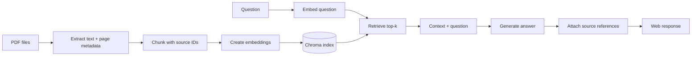

# 01 — RAG Chatbot

Chat with any collection of PDFs using Retrieval-Augmented Generation.

## Features

- Load multiple PDFs from a `docs/` directory
- Chunk and embed into ChromaDB
- FastAPI web interface with a clean HTML UI
- Chat with documents and see source citations
- Conversation history stored per session
- Beautiful terminal output via `rich`

## Quick Start

```bash
pip install -r requirements.txt
```

Create a `docs/` folder and drop PDFs inside:

```
01-rag-chatbot/
├── docs/          ← put PDFs here
├── app.py
├── requirements.txt
└── README.md
```

Run:

```bash
python app.py
```

Open **http://127.0.0.1:8000** in your browser.

## Environment Variables

| Variable | Default | Description |
|---|---|---|
| `OPENAI_API_KEY` | — | Your OpenAI API key |
| `EMBED_MODEL` | `text-embedding-3-small` | Embedding model name |
| `LLM_MODEL` | `gpt-4o-mini` | Chat completion model |
| `CHUNK_SIZE` | `1000` | Characters per chunk |
| `CHUNK_OVERLAP` | `200` | Overlap between chunks |

## How It Works



1. On startup, PDFs in `docs/` are loaded with `PyMuPDF`, chunked, and embedded into ChromaDB.
2. User sends a question via the web UI.
3. Top-k relevant chunks are retrieved from ChromaDB.
4. An LLM generates an answer using those chunks as context.
5. Source documents are shown alongside the answer.

### How to inspect a weak answer

Check the stages in order: confirm the PDF text extracted correctly; inspect the relevant chunk and its page metadata; inspect which chunks ranked top-k; then compare each answer claim with the supplied excerpts. A fluent answer is not proof of retrieval or citation quality. Increase `top_k` only after inspecting whether recall or irrelevant context is the actual issue.

The demo is a learning project, not a secure multi-tenant document service. Before deployment, add authentication, per-user access controls for indexed content, upload validation, bounded file sizes, safe persistence, and citation-grounding tests.

## API Endpoints

| Method | Path | Description |
|---|---|---|
| `GET` | `/` | Web interface |
| `POST` | `/chat` | Send a message, get answer + sources |
| `GET` | `/history` | Get conversation history |
