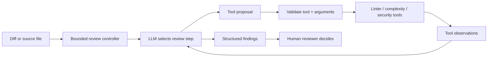

# 02 — Code Review Agent

AI-powered code review using a ReAct agent pattern with mock tooling.

## Features

- Accepts a code diff (unified format) or a raw file
- ReAct loop: think → act → observe → repeat
- Tools: linter (mock), complexity analyzer, security scanner (mock)
- Structured review output: issues, suggestions, severity ratings
- Supports Python, JavaScript, TypeScript
- Markdown report output

## Quick Start

```bash
pip install -r requirements.txt
export OPENAI_API_KEY="sk-..."
python agent.py --help
```

### Review a diff file

```bash
python agent.py --diff path/to/changes.diff
```

### Review a source file

```bash
python agent.py --file path/to/code.py
```

### Pipe from stdin

```bash
git diff HEAD~1 | python agent.py --stdin
```

## Output

The agent prints a structured Markdown report:

```markdown
# Code Review Report

## Summary
Reviewed 3 files, found 2 issues.

## Issues
| Severity | File | Line | Description |
|----------|------|------|-------------|
| HIGH | auth.py | 42 | Potential SQL injection |

## Suggestions
- Consider using parameterized queries in auth.py:42
- Add type hints to api.py

## Positive Notes
- Good error handling in utils.py
```

## Architecture



```
User Input (diff/file)
        │
        ▼
┌───────────────────┐
│  ReAct Agent Loop │◄──── LLM (GPT-4o-mini)
│                   │
│  ┌─────────────┐  │
│  │ Think       │  │   Analyze what to do next
│  │ Action      │──┼──► Call a tool
│  │ Observation │◄─┼─── Tool result
│  └─────────────┘  │
└───────┬───────────┘
        │ (max 5 iterations)
        ▼
  Markdown Report
```

## Tools

| Tool | Description |
|---|---|
| `linter` | Runs mock lint checks (naming, imports, style) |
| `complexity` | Calculates cyclomatic complexity and function lengths |
| `security` | Scans for common security anti-patterns |

**Important:** the linter and security scanner in this project are mocks for demonstrating tool orchestration. Their output is not a substitute for a real static analyzer, dependency scanner, tests, or a qualified human review. An LLM may invent a finding or overlook a defect; treat findings as suggestions and independently verify them.

### A useful review workflow

1. Keep the change small enough to fit within an explicit review context.
2. Run deterministic checks (formatter, linter, tests, secret/dependency scanners).
3. Ask the model to explain only concrete risks visible in the diff and cite file/line evidence.
4. Validate reported locations against the actual diff; discard unsupported claims.
5. Have a human approve changes. Do not let review output automatically modify or merge code.
