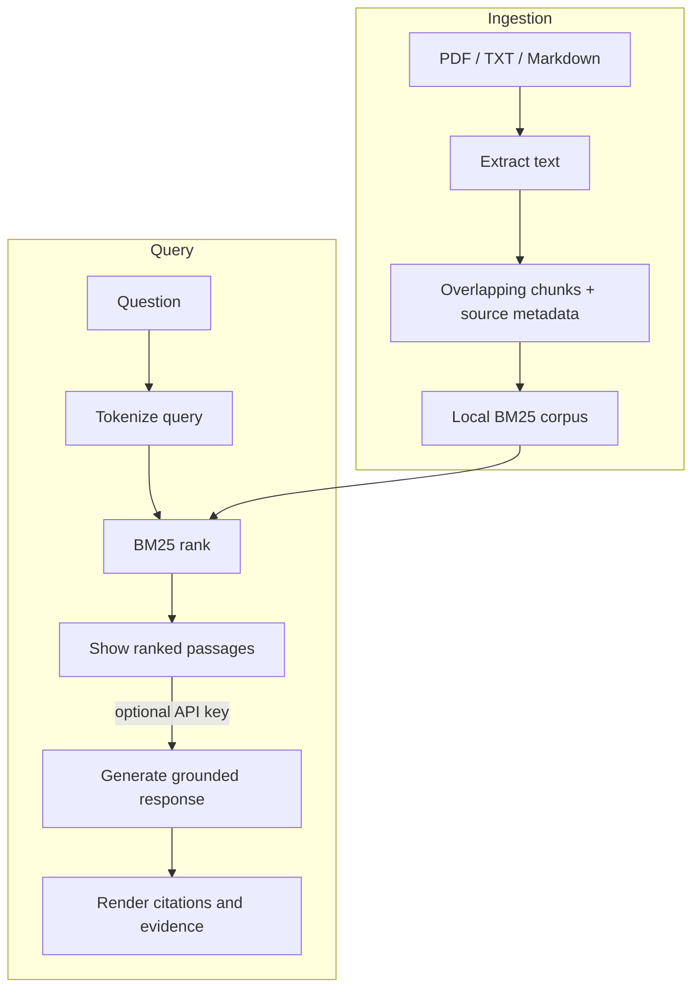

# ContextIQ — Grounded Document Q&A

An end-to-end **retrieval-augmented generation (RAG)** app. Upload PDFs, text files, or Markdown and ask questions in a chat interface. ContextIQ retrieves relevant passages with BM25, sends only those passages to an OpenAI chat model, and displays the source passages behind each answer.

> **Portfolio project:** Python · Streamlit · OpenAI API · RAG · BM25 · prompt design · evaluation

## Features

- Upload multiple PDF, TXT, and Markdown documents, or try the included sample knowledge base.
- Extract and split text into overlapping chunks, then rank passages with a lightweight BM25 retriever.
- Generate answers grounded in retrieved context, with inline source citations and expandable evidence.
- Handle unsupported questions by asking the model to say when the documents don't contain an answer.
- Preview retrieval results without an API key; only generation requires an OpenAI key.
- Keep uploaded documents in the current app session; the app does not persist them to disk.
- Run a small, reproducible retrieval benchmark with Recall@K and MRR.

## Run locally

Python 3.10 or newer is recommended.

```bash
git clone https://github.com/<YOUR-USERNAME>/LLMs.git
cd LLMs/projects/03-document-qa
python -m venv .venv
```

Activate the environment and install dependencies:

```bash
# Windows PowerShell
.venv\Scripts\Activate.ps1
pip install -r requirements.txt

# macOS / Linux
source .venv/bin/activate
pip install -r requirements.txt
```

Start the app:

```bash
streamlit run app.py
```

The app opens in your browser with the sample documents already loaded. Add an OpenAI key in the sidebar to generate LLM answers. Or create a local `.env` file:

```dotenv
OPENAI_API_KEY=your-key-here
```

The `.env` file is ignored by Git. You can change the model in the sidebar; the default is `gpt-4o-mini`.

## Deploy on Streamlit Community Cloud

1. Push this repository to your GitHub account (see the commands below).
2. Sign in at [share.streamlit.io](https://share.streamlit.io/) with GitHub and choose **Create app**.
3. Select your repository and branch, and set **Main file path** to `projects/03-document-qa/app.py`.
4. In **App settings → Secrets**, add:

   ```toml
   OPENAI_API_KEY = "your-key-here"
   ```

5. Deploy. Streamlit Cloud installs `projects/03-document-qa/requirements.txt` and provides a shareable app URL.

Never commit your API key or add it to a public GitHub repository. A key is only required for generated answers; retrieval preview works without one.

## Run tests and retrieval evaluation

From this directory:

```bash
python -m unittest discover -s tests -v
python evaluation.py
```

`evaluation.py` reports **Recall@3** (whether the expected source is retrieved in the top three passages) and **MRR** (the reciprocal rank of the first expected-source passage) on the bundled questions. The benchmark is deterministic and does not make API calls.

## How it works



1. **Ingest:** extract PDF page text with PyMuPDF or decode text/Markdown uploads.
2. **Chunk:** split each document into overlapping windows to preserve context across boundaries.
3. **Retrieve:** tokenize passages and rank them against the question with BM25.
4. **Generate:** send the question and top-ranked evidence to the OpenAI Chat Completions API.
5. **Ground:** instruct the model to use only the evidence, say when it is insufficient, and cite excerpt numbers.

BM25 is intentionally local and dependency-light: no embedding API or vector database is needed to run this starter project. For production use, consider adding semantic/hybrid retrieval, persistent indexes, authentication, and a larger evaluation set.

### Why BM25 works here

BM25 is a lexical ranking method: it scores query terms by their frequency in a passage while reducing the influence of very common terms and overly long documents. This makes the baseline fast, inspectable, and useful for exact terminology. It can miss paraphrases (“car” versus “automobile”), which is one reason to compare it with dense or hybrid retrieval on a labeled query set rather than assuming embeddings always improve results.

### Read the evaluation results

`Recall@3` asks whether the expected source occurs among the first three results. `MRR` rewards the rank of the first relevant result (`1/rank`) and averages across questions. Neither metric measures whether the generated answer is correct, whether citations support each claim, or whether the corpus itself is complete. Use the retrieval evaluation to diagnose retrieval; assess generation separately.

## Project layout

```text
03-document-qa/
├── app.py                 # Streamlit UI and LLM response generation
├── rag.py                 # Parsing, chunking, BM25 retrieval
├── evaluation.py          # Offline retrieval benchmark
├── evaluation_set.json    # Labeled benchmark questions
├── sample_docs/           # Demo knowledge base
├── tests/                 # Unit tests for the RAG pipeline
├── .streamlit/config.toml # App theme
└── requirements.txt
```

## Push to GitHub

If you are creating a new GitHub repository for this project, run these commands from the `LLMs` repository root. Replace the URL with your own repository URL:

```bash
git init
git add .
git commit -m "Build ContextIQ document Q&A app"
git branch -M main
git remote add origin https://github.com/<YOUR-USERNAME>/LLMs.git
git push -u origin main
```

If `LLMs` is already connected to your GitHub repository, just commit and push the changes from its root.
