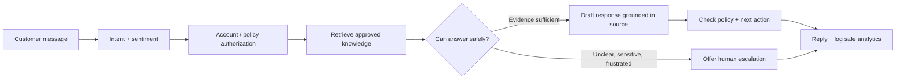

# 04 — Customer Support Bot

RAG-powered customer support bot with intent classification, sentiment analysis, and escalation.

## Features

- **Knowledge base RAG**: Ingest product docs, FAQs, and policies
- **Intent classification**: Billing, technical, general inquiry, complaint
- **Sentiment-aware responses**: Adjusts tone based on detected sentiment
- **Escalation**: Detects frustrated users and offers human handoff
- **Conversation analytics**: Tracks intent, sentiment, resolution stats
- **Multi-turn context**: Maintains conversation state across turns

## Quick Start

```bash
pip install -r requirements.txt
export OPENAI_API_KEY="sk-..."
```

Place knowledge base files in `knowledge_base/`:

```
04-customer-support-bot/
├── knowledge_base/
│   ├── faq.txt
│   ├── products.txt
│   └── policies.txt
├── bot.py
├── requirements.txt
└── README.md
```

Run:

```bash
python bot.py
```

## Knowledge Base Format

Plain text files. Separate entries with blank lines:

```
Q: How do I reset my password?
A: Go to Settings > Security > Reset Password. You'll receive an email with a link.

Q: What is your refund policy?
A: We offer full refunds within 30 days of purchase. Contact support@company.com.
```

## Conversation Flow



```
User Input
    │
    ▼
┌──────────────────┐
│ Intent Classify   │ → billing | technical | general | complaint
│ Sentiment Detect  │ → positive | neutral | negative | angry
└──────────────────┘
    │
    ▼
┌──────────────────┐
│ RAG Retrieval    │ ← knowledge_base/
└──────────────────┘
    │
    ▼
┌──────────────────┐
│ Escalation Check │ → escalate to human?
└──────────────────┘
    │
    ▼
┌──────────────────┐
│ Response Gen     │ ← sentiment-aware, intent-tailored
└──────────────────┘
```

## Analytics

Type `/analytics` to view session stats:

```
📊 Session Analytics
  Total messages: 12
  Intents: billing (5), technical (4), general (3)
  Avg sentiment: neutral
  Escalations: 0
  Resolved: 8
```

## Commands

| Command | Description |
|---|---|
| `/analytics` | View session analytics |
| `/history` | Show conversation history |
| `/reset` | Start a new conversation |
| `/quit` | Exit |

### Safe support behavior

Intent and sentiment are uncertain predictions; they should guide tone or routing, not decide eligibility, refunds, identity, or access. Require trusted account/policy systems for those decisions. Do not infer that a case was resolved just because the model produced a confident answer. Record resolution only from an explicit user signal or verified ticket state, and route uncertain/high-impact cases to a person.
