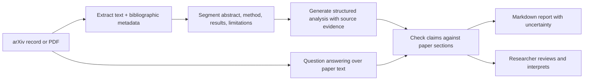

# 05 — Research Assistant

AI-powered research paper analysis agent. Extract insights from arXiv papers or PDFs.

## Features

- **Input**: arXiv URL or PDF file path
- **Extract**: title, authors, abstract, key findings, methodology, limitations
- **Generate**: summary, key contributions, related work suggestions
- **Q&A**: Ask follow-up questions about the paper
- **Compare**: Compare findings with other papers
- **Export**: Save analysis as Markdown

## Quick Start

```bash
pip install -r requirements.txt
export OPENAI_API_KEY="sk-..."
```

### Analyze an arXiv paper

```bash
python assistant.py --arxiv https://arxiv.org/abs/2301.07041
```

### Analyze a local PDF

```bash
python assistant.py --pdf path/to/paper.pdf
```

### Interactive Q&A after analysis

```bash
python assistant.py --arxiv https://arxiv.org/abs/2301.07041 --interactive
```

### Save report to file

```bash
python assistant.py --arxiv https://arxiv.org/abs/2301.07041 --output report.md
```

## Analysis Output

```markdown
# Paper Analysis: [Title]

## Metadata
- **Authors**: Author 1, Author 2, ...
- **Date**: 2023-01-17
- **arXiv**: 2301.07041

## Summary
[2-3 paragraph summary of the paper]

## Key Contributions
1. ...
2. ...

## Methodology
[Description of methods used]

## Key Findings
- Finding 1
- Finding 2

## Limitations
- Limitation 1
- Limitation 2

## Related Work Suggestions
- Paper 1 (arXiv: XXXX.XXXXX)
- Paper 2 (arXiv: XXXX.XXXXX)

## Questions & Answers
[If interactive mode was used]
```

## Interactive Commands

| Command | Description |
|---|---|
| `ask <question>` | Ask a question about the paper |
| `compare <text>` | Compare with another paper/concept |
| `summary` | Regenerate summary |
| `save` | Save analysis to Markdown |
| `quit` | Exit |

## Architecture



```
arXiv URL or PDF
       │
       ▼
┌──────────────────┐
│ Content Extractor │  fetch arXiv page / parse PDF
└──────────────────┘
       │
       ▼
┌──────────────────┐
│ Paper Analyzer    │  LLM extracts structure
└──────────────────┘
       │
       ▼
┌──────────────────┐
│ Q&A Engine        │  Interactive questions
└──────────────────┘
       │
       ▼
    Markdown Report
```

## Reading the generated analysis critically

The paper is the evidence; the assistant's report is a navigation aid. Check whether a claimed result is directly stated, whether the method description preserves assumptions, and whether limitations distinguish author-reported caveats from model inference. “Related work suggestions” are discovery leads, not verified citations—confirm titles, authors, and claims in authoritative scholarly sources before citing them.

For comparisons, align the problem setting, dataset, metrics, baselines, and evaluation protocol first. A larger score from a different benchmark or split is not necessarily evidence that one method is better.
