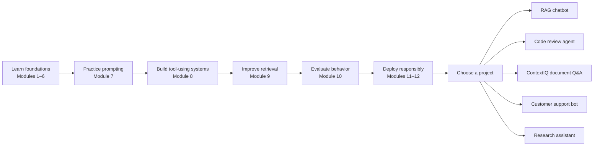

# Projects

Apply everything you've learned in 5 real-world projects. Each project combines multiple modules into a complete, working application.

---

## Projects Overview



The arrows are a recommended learning order, not a technical dependency between every project. ContextIQ, for example, is deliberately small enough to run retrieval and its evaluation set locally before adding a model API key.

| # | Project | Difficulty | Time | Modules Used |
|---|---------|-----------|------|--------------|
| 1 | [RAG Chatbot](./01-rag-chatbot/README.md) | Intermediate | 3-4 hrs | 4, 5 |
| 2 | [Code Review Agent](./02-code-review-agent/README.md) | Advanced | 4-5 hrs | 7, 8 |
| 3 | [ContextIQ — Document Q&A](./03-document-qa/README.md) | Intermediate | 3-4 hrs | 4, 5, 9 |
| 4 | [Customer Support Bot](./04-customer-support-bot/README.md) | Advanced | 5-6 hrs | 5, 6, 8 |
| 5 | [Research Assistant](./05-research-assistant/README.md) | Advanced | 4-5 hrs | 7, 8, 9 |

---

## Prerequisites

- Complete Modules 1-6 before starting projects
- Modules 7-12 recommended for Projects 2, 4, and 5
- An OpenAI API key for LLM-powered generation (Document Q&A also has a key-free retrieval preview)

---

## How to Use

Each project directory contains:
- `README.md` — Project description, architecture, and usage
- Main Python file(s) — Complete working application
- `requirements.txt` — Project-specific dependencies

For ContextIQ, install its dependencies and start the Streamlit app:

```bash
cd projects/03-document-qa
pip install -r requirements.txt
streamlit run app.py
```

For the other projects, follow the run command in each project's README.

---

## Getting Help

If you get stuck:
1. Read the project's README.md thoroughly
2. Check the module README for the concepts used
3. Open a GitHub issue if you find a bug
